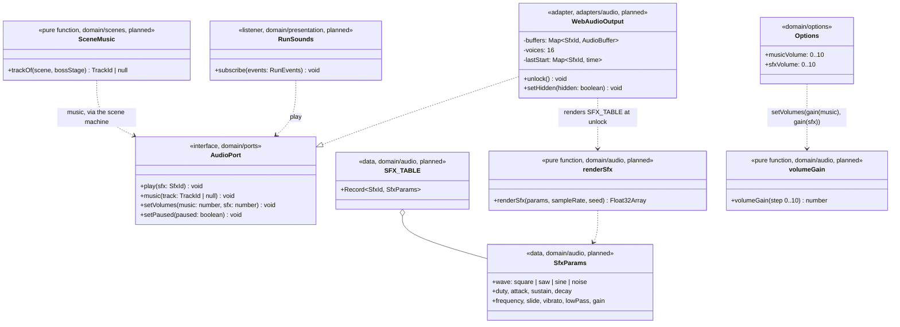

# Class and sequence diagram — audio — synthesiser, sounds and music (v0.23)

> **Source specs**: [Game Design Document](../../../design/game-design-document.md) v0.23 §9.3,
> §9.5, §6 (the warning)
> **Related ADRs**: ADR-0009 decision 3 (the audio port controls the mix), ADR-0010 (events, no
> allocation), ADR-0002 (deterministic simulation), ADR-0005 (asset licences)
> **Realizes**: the sound of every use case of play and menus; *Change options* (the *Audio*
> sub-screen). All classes are *planned* until their code PR lifts the tag.

## Context

The domain names sounds and tracks and decides **when** they play; the adapter decides **how**.
The synthesiser is pure arithmetic (no browser API), so it lives in the domain and is unit-tested;
only `WebAudioOutput` touches `AudioContext`. Sounds follow the run's events, the same way the
presenter does (ADR-0010): a listener subscribes to `RunEvents` and calls `AudioPort.play`. The
music follows the scene. Events missing for a sound (a shot fired, an enemy shot, a 1-UP) are
added to `GameEventKind` with the sound that needs them.

## Diagram



## Unlock, play and visibility

```mermaid
sequenceDiagram
  participant P as Player
  participant DI as DeviceInput (adapter)
  participant WA as WebAudioOutput (adapter)
  participant R as Run (domain)
  participant RS as RunSounds (domain)
  P->>DI: first click, tap or key
  DI->>WA: unlock() inside the gesture handler
  WA->>WA: resume AudioContext, render SFX_TABLE once
  R-->>RS: EnemyDestroyed (detail = size tier)
  RS->>WA: play(explosion of that tier)
  WA->>WA: skip if the same sound started < 33 ms ago, else start a voice (oldest stopped past 16)
  Note over WA: before unlock, play and music do nothing and queue nothing
  P->>WA: tab hidden (visibilitychange, via main.ts)
  WA->>WA: setHidden(true) suspends the context; false resumes it
```

## Rules carried

- `renderSfx` is deterministic: its noise uses the seeded generator of `domain/random`, never
  `Math.random()`; the same row and seed give the same samples.
- No allocation in the loop: buffers are rendered at unlock; `play` only starts a buffer source
  (a browser object, outside the simulation).
- The music never advances the simulation clock; the warning's fade and the boss track follow the
  scene and the run's `BossWarning` event (GDD §6).
