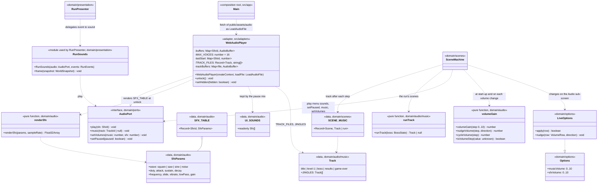
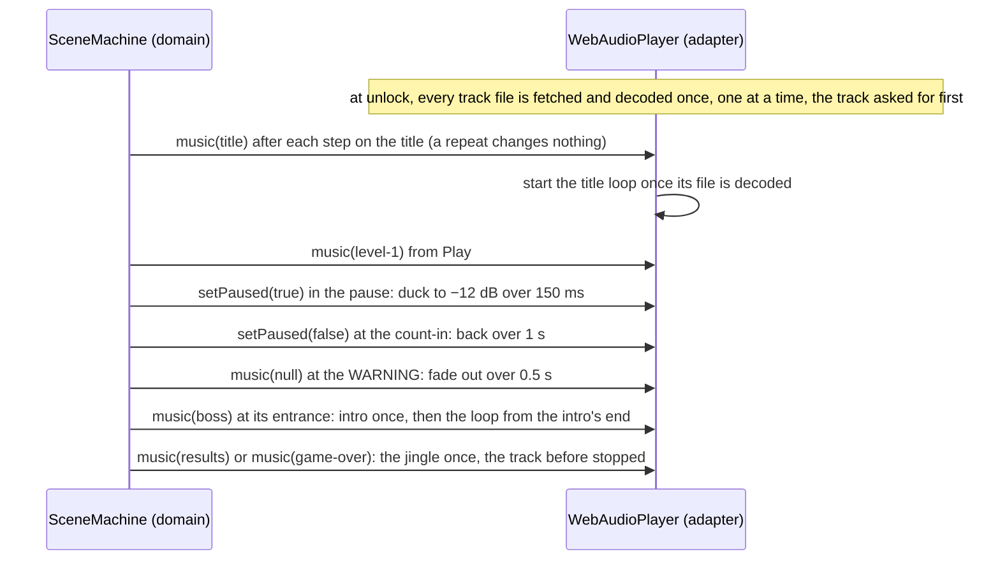

# Class and sequence diagram — audio — synthesiser, sounds and music (v0.23)

> **Source specs**: [Game Design Document](../../../design/game-design-document.md) v0.23 §9.3,
> §9.5, §6 (the warning)
> **Related ADRs**: ADR-0009 decision 3 (the audio port controls the mix), ADR-0010 (events, no
> allocation), ADR-0002 (deterministic simulation), ADR-0005 (asset licences)
> **Realizes**: the sound of every use case of play and menus; *Change options* (the *Audio*
> sub-screen). Built in G3-1 (#105: synthesiser, sound effects, pause mix) and G3-2 (music, the
> *Audio* sub-screen, the saved volumes, the remaining sounds).

## Context

The domain names sounds and tracks and decides **when** they play; the adapter decides **how**.
The synthesiser is pure arithmetic (no browser API), so it lives in the domain and is unit-tested;
only `WebAudioPlayer` touches `AudioContext`. Sounds follow the run's events: as ADR-0010 and the component
diagram say, `RunPresenter` maps events to sounds; it delegates the mapping to a small
`RunSounds` module (subscribed to `RunEvents`, calling `AudioPort.play`) so the presenter does not
grow. The adapter keeps two tables of its own, so the port stays as ADR-0009 drew it: which `SfxId`
are menu sounds (kept by the pause mix), and per `TrackId` its files (`TRACK_FILES`: the boss
track's intro, played once, then its loop; the jingles play once, every other track loops). The
music follows the scene: the scene machine looks its track up in `SCENE_MUSIC` after each step,
the run's scenes through `runTrack(boss state)`, and the adapter acts on a change only. Shots have no event *(owner, G3-1, 470/500 over new
`PlayerFired` / `EnemyFired` events)*: `World` counts the bullets it spawns (`playerShots`,
`enemyShots`, exposed by the snapshot) and `RunSounds.frame` plays one shot sound per drawn frame
whose counter moved, so a five-bullet volley is one sound and the simulation only counts. Menu
sounds come from the scene machine's `stepMenu` (a highlight move, an activation) in the title,
pause, options and *Audio* menus, and from a change of the highlighted cell or an action on the
controls and name-entry screens. `RunSounds.frame` plays the chain step when the multiplier rises;
the Results scene plays the tally tick on each new line (`tallyLineAppears`).

## Diagram



## Unlock, play and visibility

```mermaid
sequenceDiagram
  participant P as Player
  participant M as main.ts (composition root)
  participant DI as DeviceInput (adapter)
  participant WA as WebAudioPlayer (adapter)
  participant R as Run (domain)
  participant RS as RunSounds (domain)
  P->>DI: first click, tap or key
  DI->>WA: unlock() inside the gesture handler
  WA->>WA: resume AudioContext (in the handler), then render SFX_TABLE once just after it
  R-->>RS: EnemyDestroyed (detail = size tier)
  RS->>WA: play(explosion of that tier)
  WA->>WA: skip if the same sound started < 33 ms ago, else start a voice (oldest stopped past 16)
  Note over WA: before unlock, play does nothing; music only remembers the scene's track
  P->>M: tab hidden (visibilitychange)
  M->>WA: setHidden(true) suspends the context; false resumes it
```

## Music through a run



## Rules carried

- `renderSfx` is deterministic: its noise uses its own `SeededRandom` seeded with a constant
  per row, never the run's stream (rendering at unlock must not shift the gameplay sequence,
  ADR-0002) and never `Math.random()`; the same row gives the same samples.
- No allocation in the loop: buffers are rendered at unlock; `play` only starts a buffer source
  (a browser object, outside the simulation).
- The music never advances the simulation clock; the warning's fade and the boss track follow the
  scene and the boss's state (GDD §6), read from the snapshot after each step.
- A track file that fails to fetch or decode leaves that track silent; the game plays on.
