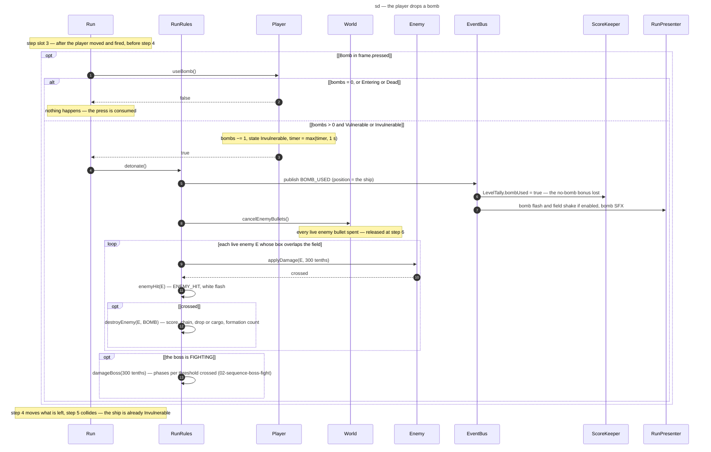

# Sequence diagram — gameplay — the player drops a bomb (1.0)

> **Source specs**: [Game Design Document](../../../design/game-design-document.md) v0.10 §4.1,
> §4.5, §5.2, §6, §8, §9.3, §9.4
> **Related ADRs**: ADR-0002 (fixed step order), ADR-0010 (bus per run, handler rules, effects in
> wall time), ADR-0014 (field-only shake), ADR-0019 (step slot 3, damage in tenths, `BOMB_USED`), ADR-0022
> (`damageBoss`, `LevelTally`)
> **Realizes**: UC1 extension 5a of [01-use-case](../system/01-use-case.md); the bomb transitions
> of [05-state-player](05-state-player.md); classes of [04-class-domain](04-class-domain.md)

## Context

What a `Bomb` press does inside one `Run.step`, at slot (3): after the player has moved and
fired, before anything else moves or collides. The bomb cancels every enemy bullet, damages every
enemy on the field once through the normal kill path, and protects the ship; the score, the
tally and the effects react to events. Kills follow
[02-sequence-enemy-destroyed](02-sequence-enemy-destroyed.md) from `destroyEnemy(E, BOMB)`.

## Diagram

## Notes

- **One step, once** (GDD v0.8 §4.5): the damage is dealt in the step of the press and never
  again; an enemy still fully outside the field is untouched and enters later unharmed. The
  destroyed bodies are only marked (`spent`) and released at step 6, like a shot kill.
- **Same path as a shot kill**: `applyDamage` returns `true` only on the crossing to 0 HP, so an
  enemy already destroyed by a shot this step, or by a bomb, never scores twice. Bomb kills extend
  the chain and count toward the full-formation P (GDD v0.3 §5.2); a bomb-killed Carrier drops its
  cargo. Every pickup spawned here starts moving at step 4.
- **Guard** (05-state-player): only `Vulnerable` or `Invulnerable` can bomb. `Entering`, `Dead`,
  after Game over (the ship stays `Dead`) and the pause (the run is not stepped) never do. One
  bomb per press: `pressed` latches a press once (ADR-0009), and holding the button does not repeat.
- **Invulnerability first**: `useBomb` sets the state before step 5, so the step's collisions
  already ignore the ship; `max(timer, 1 s)` never shortens a longer protection, and from
  `Vulnerable` the blink count starts at 0.
- **Event order**: `BOMB_USED` is published before the bullets are cancelled and the enemies hit,
  so every listener sees the bomb before the kills it causes; the presenter records its effects
  only (ADR-0010).
- **Effects** (GDD v0.8 §9.4): the bomb flash tints the play field for about 300 ms of wall time
  and the shake moves field draws only (ADR-0014); each has its own switch in `EffectSettings`
  (`bombFlash`, `shake`), both outcome-neutral. A new flash starts only 1/3 s or more after the
  previous one started, so a burst of bombs stays at or under 3 flashes per second.
- **Tally**: `BOMB_USED` is published from the player-kit brick; `LevelTally` subscribes to it
  from the level brick (F-3, ADR-0022), and any bomb used in the level loses the no-bomb bonus.
- **The boss** (GDD v0.10 §6): a bomb damages it only while it is `FIGHTING` — in `WARNING` and
  `ENTERING` the bomb still cancels the bullets and hits the enemies on the field, not the boss;
  a bomb crossing a threshold advances the phase (05-state-boss).
