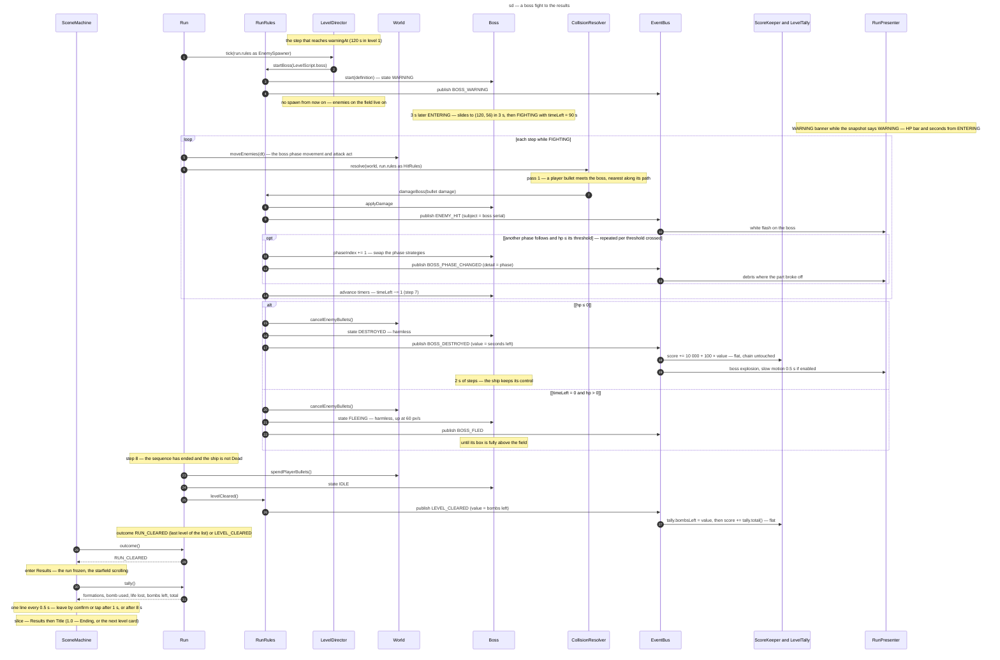

# Sequence diagram — gameplay — a boss fight to the results (1.0)

> **Source specs**: [Game Design Document](../../../design/game-design-document.md) v0.10 §4.5,
> §6, §6.1, §7.2.2, §8, §9.1, §9.2, §9.4
> **Related ADRs**: ADR-0002 (fixed step order), ADR-0010 (bus per run, time scale), ADR-0022
> (`startBoss`, `damageBoss`, boss and level events, `LevelTally`, `Results`)
> **Realizes**: UC1 steps 7–9 and extension 8a of [01-use-case](../system/01-use-case.md); the
> transitions of [05-state-boss](05-state-boss.md); classes of
> [04-class-domain](04-class-domain.md); the `Results` scene of
> [05-state-scenes](../meta/05-state-scenes.md)

## Context

The end of a level across many steps: the director reaches `warningAt` and starts the boss, the
boss warns and enters, shots damage it through `damageBoss` until its thresholds and its 0 HP, its
dying sequence ends the level, the tally is added and the scene machine shows the results. Inside
one step the fixed order of [04-class-domain](04-class-domain.md) holds; a bomb on the boss follows
[02-sequence-bomb](02-sequence-bomb.md) into `damageBoss`.

## Diagram

## Notes

- **Where the tally comes from**: `LevelTally` is fed during the whole level by its
  subscriptions — `FORMATION_CLEARED` (+1, bomb kills included, 02-sequence-enemy-destroyed),
  `BOMB_USED` (02-sequence-bomb), `PLAYER_DIED` (02-sequence-player-hit; a shield absorb
  publishes `PLAYER_HIT` and keeps the no-miss) — and closed by `LEVEL_CLEARED`. It is reset when
  the next level starts.
- **Only `FIGHTING` takes damage**: `damageBoss` is reached only from pass 1 while the boss is
  `FIGHTING` and from a bomb in `FIGHTING`; one bomb crossing two thresholds publishes two
  `BOSS_PHASE_CHANGED`. Pass 3 tests the boss body against the ship in `ENTERING` and
  `FIGHTING`, through `HitRules.playerDied` like any body (02-sequence-player-hit).
- **Order at the end**: the boss events are published inside `damageBoss` (step 5) or at the
  timer's expiry (step 7); `LEVEL_CLEARED` at step 8, after the sequence, so the score shown by
  the results already includes the boss bonus and the tally. A level end is deferred while the
  ship is `Dead`; a final death sets `GAME_OVER`, which wins.
- **Determinism**: every boss pattern is a function of its body, its volley count and the ship's
  position (ADR-0022); no random draw. The slow motion is a time scale in the loop (ADR-0010): it
  delays steps, never changes them.
- **Interim (F-2, before F-3)**: no tally and no `Results` yet; `RUN_CLEARED` shows a "LEVEL
  CLEAR" banner for 3 s, then the title (meta/05-state-scenes, level brick additions).
