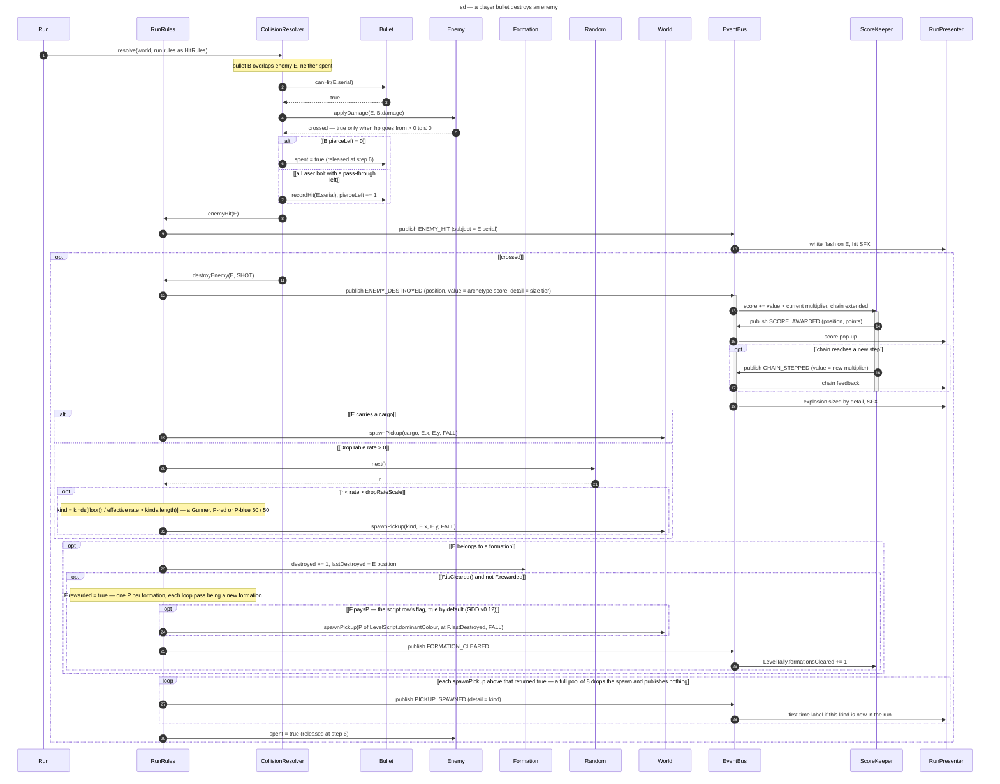
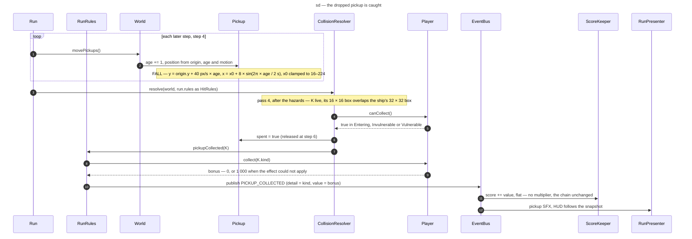

# Sequence diagram — gameplay — a player bullet destroys an enemy (1.0)

> **Source specs**: [Game Design Document](../../../design/game-design-document.md) v0.10 §4.3,
> §4.6, §5.2, §5.2.1, §7.3, §8, §9.4
> **Related ADRs**: ADR-0002 (pools, seeded Random), ADR-0003 (Observer), ADR-0010 (bus per run,
> handler rules, `DropTable` as data), ADR-0019 (run seed, pierce memory, pickups, formations), ADR-0022 (`LevelTally`, `damageBoss`)
> **Realizes**: UC1 steps 5–6 of [01-use-case](../system/01-use-case.md); classes of
> [04-class-domain](04-class-domain.md)

## Context

The most frequent collaboration of the game, inside the collision pass of one `Run.step`: a
player bullet meets an enemy, damages it, destroys it, maybe drops a pickup, maybe clears a
formation; the score, the effects and the sounds react without the entities knowing them; a
second diagram follows the pickup until the ship catches it. Bomb kills enter at
`destroyEnemy(E, BOMB)` and follow the same path (02-sequence-bomb). Enemy bullets and bodies hitting
the player are in `02-sequence-player-hit`; boss hits go through `damageBoss` and publish
`ENEMY_HIT` with the boss serial, and score nothing (02-sequence-boss-fight).

## Diagram

## Diagram — the pickup is caught

## Notes

- **Destroyed at most once**: `applyDamage` returns `true` only on the crossing to 0 HP, and the
  `spent` mark (spent bodies and bullets are skipped by the rest of the step) prevent a double score, a
  double roll and a double formation count when two bullets or a bomb and a bullet meet the same
  enemy in one step.
- **Mark now, release at step 6**: `World.sweep()` is the single entry point of step 6 and
  delegates to each `ActiveList.sweep`, the only caller of `pool.release` (04-class-domain, mark
  then release), so no pool ever sees a double release. `ENEMY_DESTROYED`
  carries its position and size tier because `E` is gone before the frame is drawn.
- **Spawning is a direct call, never a handler** (ADR-0010): pickups, the formation reward and
  the `spent` mark happen in `RunRules.destroyEnemy`, in this fixed order — the pool release waits for
  `World.sweep()` at step 6; only `ScoreKeeper` changes
  state from a handler, and the presenter only reacts.
- **Subscription order**: `ScoreKeeper` first (subscribed by `Run`'s constructor), `RunPresenter`
  second (subscribed by the scene machine). `ScoreKeeper` publishes
  `SCORE_AWARDED` and `CHAIN_STEPPED` from its handler — other kinds than the one it handles, so
  the reused event objects stay valid (ADR-0010 invariants).
- **Chain rule** (GDD v0.4 §8): the kill is scored at the current multiplier, then the chain
  steps up; the chain timer restarts on every kill.
- **Random draws**: one draw per destroyed enemy whose `DropTable` rate is above 0 and that has no
  cargo; the same `r` picks the kind (a Gunner's red or blue); draws happen in collision-pass
  order, so a replay reproduces every drop. The `Random` is the run's, seeded from the run seed
  (ADR-0019). Pickup sway is a pure function of the pickup's age — no draw.
- **Formations per pass**: the director starts a new `Formation` for each pass of a looping row,
  so the same row earns its P again on every loop; the P spawns at the last member destroyed,
  even above the field, and falls into view (GDD v0.8 §4.6).
- **No drop on escape**: an enemy leaving the field is released at step 6 with no roll and no
  cargo; only a kill drops (an escaped Carrier keeps its cargo).
- **Collection** (second diagram): pass 4 runs after the hazard passes, so a ship that died in the
  same step collects nothing; several pickups in one step are collected in the order of the active pickup list, each
  applied at once. A pickup the ship cannot collect (`Dead`, after Game over) keeps falling and
  is lost at the bottom. The bonus is flat (GDD v0.8 §4.6): `ScoreKeeper` adds `value` without
  the multiplier and neither extends nor breaks the chain. `PICKUP_SPAWNED` and
  `PICKUP_COLLECTED` both enter the determinism test's event log.
- **Piercing**: `canHit` / `recordHit` use serials, so a bolt never hits the same body twice
  and a recycled pool enemy is not mistaken for the old one; a Spread bullet has no
  pass-through and is spent on its first hit. Damage is in tenths of a level-1 shot
  (ADR-0019).
- **First-time labels** cover every spawn path (drop, cargo, formation reward, death release),
  including the very first formation of level 1 (GDD §7.3); they wait for the bitmap fonts
  (interim deviation, meta/05-state-scenes).
