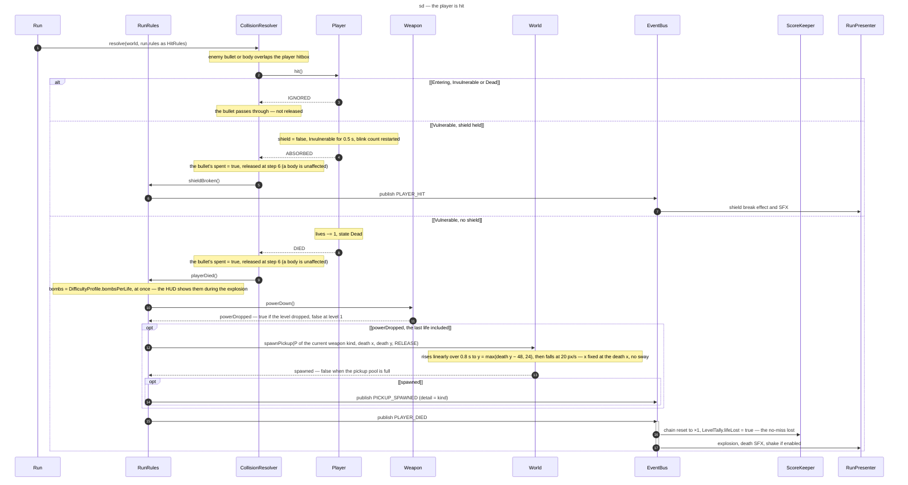

# Sequence diagram — gameplay — the player is hit (1.0)

> **Source specs**: [Game Design Document](../../../design/game-design-document.md) v0.10 §4.1,
> §4.4, §4.6, §5.2, §6, §8
> **Related ADRs**: ADR-0002 (pools), ADR-0010 (bus per run, handler rules), ADR-0019 (release
> motion, `ABSORBED`, `shieldBroken`, `DifficultyProfile`), ADR-0022 (`LevelTally`, boss contact)
> **Realizes**: UC1 extensions 5b, 5c and 5c1 of [01-use-case](../system/01-use-case.md);
> lifecycle in [05-state-player](05-state-player.md)

## Context

What happens when an enemy bullet or an enemy or boss body overlaps the player's 4 × 4 hitbox,
with every branch of GDD §4.4: ignored, absorbed by a shield charge, or a life lost with the
power penalty and its release. The timing — invulnerability, respawn, Game over at the end of
the death sequence — belongs to the player's state machine.

## Diagram

## Notes

- **At most one non-ignored outcome per step**: once the ship is `Dead` every further hit in the
  same step — a second bullet, a body — returns `IGNORED`, so two lives can never be lost at once.
- **Invulnerable means untouchable** (GDD v0.4 §4.1): bullets and bodies pass through an
  entering, invulnerable or dead ship; only a hit that counts consumes the bullet.
- **Game over is not decided here**: the hit always returns `DIED`; when the death sequence ends,
  `05-state-player` either respawns the ship or, with no life left, sets the run outcome to
  `GAME_OVER` (GDD v0.4 §4.4 — the last explosion plays out).
- **The player decides the outcome, the run applies the penalties**: `Player.hit()` returns
  `IGNORED`, `ABSORBED` or `DIED`; `RunRules.playerDied()` applies what needs the difficulty profile
  and the world — bombs, power, release.
- **No release at power 1** (GDD v0.2 §4.4): `powerDown()` returns `false` and nothing spawns.
  The weapon kind never changes on death.
- **The release hop** (GDD v0.8 §4.4): the v0.2 drift at 40 px/s left the field 1.4 s after the
  death, before the ship returns at 2 s. The `RELEASE` motion first rises, then falls at half the
  normal speed: the rise is linear over 0.8 s whatever its height (clamped at y 24 it simply
  rises less); x stays at the death x, with no sway, during the rise and the fall. From the
  resting line it stays catchable about 4 s after control returns. It is
  an ordinary P (the cap rule applies), released on the last life too — the run plays on after
  Game over, and the rule stays uniform.
- **Shield** (GDD v0.8 §4.4): a bullet or a body contact both consume the charge; the bullet is
  spent, the body survives. `PLAYER_HIT` is published by
  `HitRules.shieldBroken()`, which `RunRules` realizes.
- **Order**: the release pickup spawns before `PLAYER_DIED` is published, so every listener sees
  a consistent world; `ScoreKeeper` resets the chain before the presenter reacts.
- **Bombs reset to the difficulty value** (`bombsPerLife`, GDD §10), not to a literal.
- **Tally** (GDD v0.10 §8): only `PLAYER_DIED` breaks the no-miss; an absorbed hit publishes
  `PLAYER_HIT`, to which `LevelTally` does not subscribe.
- **Boss body** (GDD v0.10 §6): pass 3 tests it while the boss is `ENTERING` or `FIGHTING`, never
  in `DESTROYED` or `FLEEING`; it survives the contact like any body.
