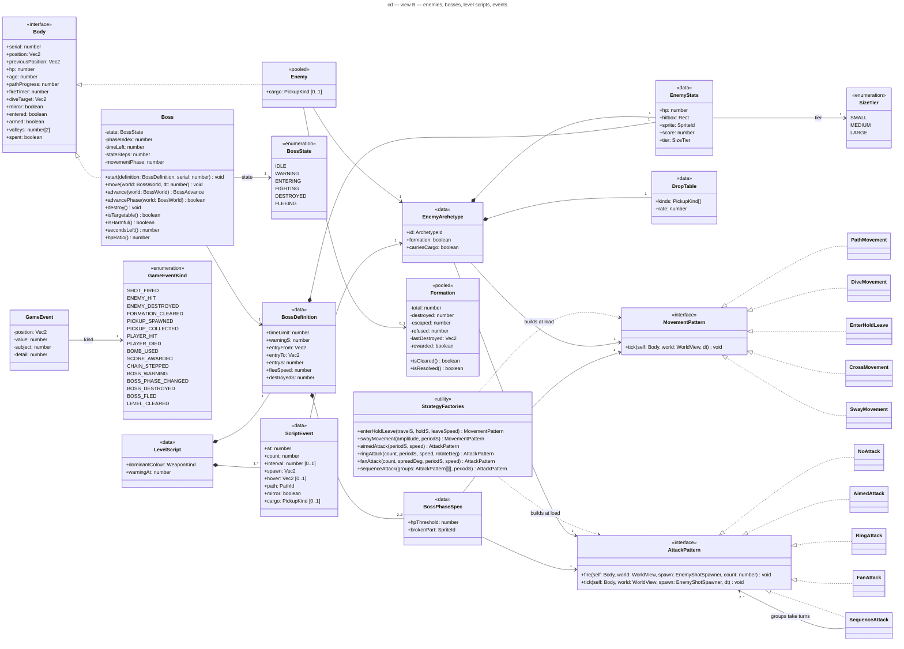

# Class diagram — gameplay — domain model of a run (1.0)

> **Source specs**: [Game Design Document](../../../design/game-design-document.md) v0.10 §4–§8 (with §5.2.1, §6.1, §7.2.1 and §7.2.2), §9.2, §10
> **Related ADRs**: ADR-0002 (Simulation, Random, Pool), ADR-0003 (composition, patterns),
> ADR-0009 (IntentFrame), ADR-0010 (event bus per run, `DropTable` as data,
> presentation outside the outcome), ADR-0019 (run seed, damage in tenths, weapons as data,
> pickups, formations), ADR-0022 and ADR-0023 (strategy factories, the boss outside the enemy pool,
> level list, the boss fight's attack timers and movement age)
> **Realizes**: UC1 of [01-use-case](../system/01-use-case.md); the structure is placed in
> [03-component](../system/03-component.md) (`Run` component)

## Context

The types of the `Run` component: everything that decides the **outcome** of a run, nothing
that only presents it (`RunPresenter`, ADR-0010). Two views of one model:

- **A — run, world, player, scoring**: who owns what during a run, how rules are applied;
- **B — enemies, bosses, level scripts, events**: how enemies are composed from data and
  stateless strategies, and what the run tells its listeners.

Port signatures are owned by their ADRs and are not repeated. The scene machine is in
`meta/05-state-scenes`; the player's and the boss's lifecycles in `gameplay/05-state-*`.
Attributes shown are the ones the GDD rules need, not an exhaustive field list.

**Stereotype legend**: «interface» and «enumeration» are standard UML; «data» marks an
immutable record loaded from the level scripts (shared by every instance using it); «pooled»
marks a class whose instances come from a `Pool<T>` (ADR-0002) and are recycled, never
allocated in the loop; «utility» marks a stateless function module.

## Diagram A — run, world, player, scoring

```mermaid
---
title: cd — view A — run, world, player, scoring
---
classDiagram
  direction LR

  class Simulation {
    <<interface>>
    +step(dt, frame: Readonly~IntentFrame~) void
  }
  class RunView {
    <<interface>>
    +levelIndex() number
    +outcome() RunOutcome
    +tally() LevelTally
    +snapshot() WorldSnapshot
    +events() RunEvents
  }
  class RunEvents {
    <<interface>>
    +subscribe(kind, handler) void
  }
  class HitRules {
    <<interface>>
    +enemyHit(enemy: Enemy) void
    +shieldBroken() void
    +pickupCollected(pickup: Pickup) void
    +destroyEnemy(enemy: Enemy, cause: KillCause) void
    +damageBoss(amount: number) void
    +playerDied() void
  }
  class Run {
    -levelIndex: number
    -runSeed: number
    +Run(config: RunConfig)
    +step(dt, frame: Readonly~IntentFrame~) void
    +startNextLevel() void
  }
  class RunRules {
    +enemyHit(enemy) void
    +destroyEnemy(enemy) void
    +damageBoss(amount) void
    +pickupCollected(pickup) void
    +playerDied() void
    +shieldBroken() void
    +startFormation(total) Formation
    +spawnEnemy(event, formation) boolean
    +startBoss(definition) void
    +advanceBoss() boolean
    +levelCleared() void
    +detonate() void
  }
  class RunConfig {
    <<data>>
    +levels: LevelScript[]
    +seed: number
    +createRandom(levelSeed: number) Random
  }
  class Random {
    <<interface>>
    +next() number
    +seed(s: number) void
  }
  class RunOutcome {
    <<enumeration>>
    PLAYING
    LEVEL_CLEARED
    RUN_CLEARED
    GAME_OVER
  }
  class DifficultyProfile {
    <<data>>
    +lives: number
    +bombsPerLife: number
    +startShieldCharges: number
    +powerLossOnDeath: number
    +enemyHpScale: number
    +bulletSpeedScale: number
    +dropRateScale: number
  }
  class World {
    -playerBullets: Pool~Bullet~
    -enemyBullets: Pool~Bullet~
    -pickups: Pool~Pickup~
    -enemies: Pool~Enemy~
    -formations: Pool~Formation~
    -boss: Boss
    +spawnPickup(kind: PickupKind, x, y, motion: PickupMotion) boolean
    +cancelEnemyBullets() void
    +spendPlayerBullets() void
    +sweep() void
  }
  class EnemySpawner {
    <<interface>>
    +spawnEnemy(event: ScriptEvent, formation: Formation [0..1]) void
    +startFormation(total: number) Formation [0..1]
    +startBoss(definition: BossDefinition) void
  }
  class WorldView {
    <<interface>>
    +playerPosition() Vec2
    +time() number
  }
  class PlayerShotSpawner {
    <<interface>>
    +spawnPlayerBullet(x, y, shot: ShotSpec) void
  }
  class EnemyShotSpawner {
    <<interface>>
    +spawnEnemyBullet(x, y, vxPerSecond, vyPerSecond) void
  }
  class Player {
    -position: Vec2
    -previousPosition: Vec2
    -lives: number
    -bombs: number
    -shield: boolean
    -stateSteps: number
    -protectionSteps: number
    +update(frame: Readonly~IntentFrame~, dt, spawner: PlayerShotSpawner) void
    +advanceTimers() void
    +hit() HitOutcome
    +useBomb() boolean
    +canCollect() boolean
    +collect(kind: PickupKind) number
  }
  class PlayerState {
    <<enumeration>>
  }
  note for PlayerState "Values and transitions in 05-state-player"
  class HitOutcome {
    <<enumeration>>
    IGNORED
    ABSORBED
    DIED
  }
  class Weapon {
    -kind: WeaponKind
    -level: number
    -cooldown: number
    +tick(origin: Readonly~Vec2~, firing: boolean, spawner: PlayerShotSpawner) void
    +powerUp(kind: WeaponKind) boolean
    +powerDown() boolean
  }
  class WeaponKind {
    <<enumeration>>
    SPREAD
    LASER
  }
  class WeaponLevel {
    <<data>>
    +cooldownSteps: number
    +shots: ShotSpec[]
  }
  class ShotSpec {
    <<data>>
    +offsetX: number
    +offsetY: number
    +vxPerSecond: number
    +vyPerSecond: number
    +width: number
    +height: number
    +damage: number
    +pierce: number
    +weapon: WeaponKind
  }
  class Bullet {
    <<pooled>>
    -position: Vec2
    -previousPosition: Vec2
    -velocity: Vec2
    -hitbox: Rect
    -damage: number
    -pierceLeft: number
    -weapon: WeaponKind
    -alreadyHit: number[3]
    -alreadyHitCount: number
    -spent: boolean
    +canHit(serial: number) boolean
    +recordHit(serial: number) void
    +forgetHits() void
  }
  class Pickup {
    <<pooled>>
    -serial: number
    -origin: Vec2
    -position: Vec2
    -previousPosition: Vec2
    -age: number
    -spent: boolean
  }
  class PickupMotion {
    <<enumeration>>
    FALL
    RELEASE
  }
  class PickupKind {
    <<enumeration>>
    P_RED
    P_BLUE
    SHIELD
    BOMB
    ONE_UP
  }
  class Pool~T~ {
    <<interface>>
    +acquire() T | undefined
    +release(item: T) void
    +size: number
  }
  class ScoreKeeper {
    -chainKills: number
    -chainTimer: number
    +score() number
    +multiplier() number
    +chainRatio() number
    +tick() void
  }
  class LevelTally {
    +formationsCleared: number
    +bombUsed: boolean
    +lifeLost: boolean
    +bombsLeft: number
    +total() number
  }
  class TallyTuning {
    <<data>>
    +perFormation: number
    +noBomb: number
    +noMiss: number
    +perBombLeft: number
  }
  class Boss {
  }
  class Formation {
  }
  class LevelScript {
  }
  note "Boss, Formation, LevelScript and GameEvent are detailed in view B"
  class CollisionResolver {
    <<utility>>
    +resolve(world: World, rules: HitRules) void
  }
  class LevelDirector {
    -scriptStep: number
    -cursor: number
    +tick(spawner: EnemySpawner) void
  }
  class EventBus {
    <<interface>>
    +subscribe(kind, handler) Unsubscribe
    +publish(event: GameEvent) void
  }
  class GameEvent {
  }

  Simulation <|.. Run
  RunView <|.. Run
  HitRules <|.. RunRules
  RunEvents <|.. EventBus
  Run --> "1" RunOutcome : outcome
  Run *-- "1" World
  Run *-- "1" ScoreKeeper
  Run *-- "1" LevelDirector
  Run *-- "1" RunRules : the world rules, exposed as rules
  RunRules --> "1" World : acts on
  Run *-- "1" EventBus
  Run --> "1" DifficultyProfile
  Run --> "1..*" LevelScript : levels, in order
  Run *-- "1" Random : gameplay stream, seeded per level
  Run ..> RunConfig : built from
  Run ..> CollisionResolver : uses each step
  WorldView <|.. World
  PlayerShotSpawner <|.. World
  EnemyShotSpawner <|.. World
  EnemySpawner <|.. RunRules
  LevelDirector ..> EnemySpawner : spawns through (parameter)
  World *-- "1" Player
  World *-- "1" Boss : preallocated, outside the enemy pool
  World *-- "0..*" Formation
  World --> "0..*" Bullet : active
  World --> "0..*" Pickup : active
  Player *-- "1" Weapon
  Player ..> PlayerShotSpawner : fires through (parameter)
  Player --> "1" PlayerState : state
  Player ..> HitOutcome
  Weapon --> "1" WeaponKind : kind
  Weapon ..> WeaponLevel : reads WEAPONS[kind][level − 1]
  WeaponLevel *-- "1..5" ShotSpec : shots
  Pickup --> "1" PickupKind : kind
  Pickup --> "1" PickupMotion : motion
  ScoreKeeper *-- "1" LevelTally
  LevelTally ..> TallyTuning : reads
  ScoreKeeper ..> EventBus : subscribed first by Run
  EventBus ..> GameEvent : dispatches
  LevelDirector --> "1" LevelScript : walks
```

## Diagram B — enemies, bosses, level scripts, events

## How each GDD rule is carried

| Rule (GDD v0.4–v0.10) | Where it lives |
|---|---|
| Two weapons × 5 levels, Spread first, switch keeps the level (§4.3) | `Weapon.powerUp(kind): boolean` sets `kind` and raises `level` (true when it rose); `WEAPONS[kind][level − 1]` is a `WeaponLevel` record and one generic `fire()` spawns its `ShotSpec`s (ADR-0019 — no `WeaponPattern`); `cooldown` counts `cooldownSteps` and is kept across a switch |
| Laser width and piercing (§4.3, v0.8) | 48 px bolts from the player bullet pool with `pierceLeft` (the pass-throughs, 1 to 3) and `alreadyHit` — the **serials** of the bodies already hit, enemies and boss alike, 3 at most — so one body is hit once per bolt, even when a pooled enemy is reused or the bolt overlaps a large boss for several steps; when a bolt overlaps more bodies than it can hit, it hits them in the order it meets them along its path (nearest first: smallest position · velocity), never in the active list's order; every body crossed takes the full damage; a hit with `pierceLeft` = 0 spends the bolt |
| One hit = one life, shield charge, invulnerability (§4.4) | `Player.hit(): HitOutcome` — `IGNORED` while entering, invulnerable or dead (the bullet passes through), `ABSORBED` by the shield, `DIED` otherwise; Game over is decided when the death sequence ends (`05-state-player`) |
| Next level, run cleared (§2, §7, v0.10 §9.1) | `RunConfig.levels` is the ordered level list (data); `Run.startNextLevel()` resets the outcome, the tally and the level script, reseeds `Random` from the run seed and the level index; the outcome is `LEVEL_CLEARED` after a level that has a successor, `RUN_CLEARED` after the last — in the vertical slice the list holds level 1 only, so its end is `RUN_CLEARED` (ADR-0022) |
| Death: −1 level and release, none at level 1 (§4.4, v0.8) | `Weapon.powerDown(): boolean`; `Run.playerDied()` resets the bombs to `DifficultyProfile.bombsPerLife`, calls `powerDown()` and, when it returns `true`, spawns a P of the current kind with `PickupMotion.RELEASE` (the hop, then the slow fall) before publishing `PLAYER_DIED`; on the last life too |
| Bombs per life, cap, empty stock, hit the boss (§4.5, v0.8) | at step slot (3), on a `Bomb` press, `Player.useBomb(): boolean` (stock > 0, `Vulnerable` or `Invulnerable`; sets the timer to max(time left, 1 s)); on `true` the run publishes `BOMB_USED`, calls `World.cancelEnemyBullets()` and deals 300 tenths once to every live enemy overlapping the field through `applyDamage`, `enemyHit` and `destroyEnemy(enemy, BOMB)`; the boss through `damageBoss` (02-sequence-bomb) |
| Pickup at its cap → 1 000 points (§4.6, v0.8) | `Player.collect(kind): number` returns the bonus, 0 or 1 000 (an other-colour P at level 5 switches **and** returns 1 000); `PICKUP_COLLECTED` carries the kind in `detail` and the bonus in `value`; `ScoreKeeper` adds `value` flat, outside the chain |
| Pickup collection box 32 × 32, player hitbox 4 × 4 (§4.1, §4.6, v0.8) | `CollisionResolver` pass 4, after the hazards: live 16 × 16 pickups against the ship's 32 × 32 box while `Player.canCollect()` (`Entering`, `Invulnerable`, `Vulnerable`); each collected one is marked `spent`, in the order of the active pickup list; bullets and bodies test the 4 × 4 hitbox |
| First-time pickup labels (§7.3) | `PICKUP_SPAWNED` carries the kind in `detail`; `RunPresenter` remembers which kinds it has labelled this run (presentation only, ADR-0010) |
| Contact hits the player (§5.2) | `CollisionResolver`: player hitbox (4 × 4) against enemy and boss hitboxes |
| Roles as data lines (§5.2, §5.3) | `EnemyArchetype` = `EnemyStats` + `DropTable` + one movement + one attack |
| Carrier cargo set by the script (§5.2, v0.8 §5.2.1) | `ScriptEvent.cargo` → `Enemy.cargo`, which overrides the `DropTable` roll (ADR-0010); the load check throws a `RangeError` for a Carrier row without a cargo or a cargo on another archetype; an escaped Carrier drops nothing, a bomb kill drops the cargo |
| Formation guarantee, bomb kills count (§5.2) | `Formation` counts destroyed, escaped and refused, and keeps the position of its last destroyed member; one completion check, `Run.resolveFormationMember`, runs whenever a member resolves (destroyed, escaped at step 6, or refused by the director) and, the first time `isCleared()` holds, spawns the P at that position and publishes `FORMATION_CLEARED`, once; one `Run.destroyEnemy(enemy, cause)` path for shots and bombs updates `Enemy.formation`; the boss has its own `Run.damageBoss` path (no formation) |
| Boss phases, timer, flee, broken parts (§6, v0.10 §6.1) | one preallocated `Boss` in `World`, outside the enemy pool (ADR-0022); `Boss.state` (`BossState`), `phaseIndex`, `timeLeft` in steps; `BossPhaseSpec.hpThreshold`, `brokenPart`, movement and attack; `Boss.start(definition)` resets every field from the `BossDefinition`; lifecycle and the Cruiser's values in `05-state-boss` |
| Boss damage, targetable only while fighting (v0.10 §6) | `HitRules.damageBoss(amount)`: `applyDamage`, `ENEMY_HIT` with the boss serial, then one `BOSS_PHASE_CHANGED` per threshold crossed, or `BOSS_DESTROYED` at 0 HP; collision pass 1 adds the boss to the nearest-target candidates only while `isTargetable()` (`FIGHTING`); pass 3 tests its body while `isHarmful()` (`ENTERING`, `FIGHTING`); the bomb calls `damageBoss(300)` only in `FIGHTING` |
| Boss bonus 10 000 + 100 × seconds left, flat (§6, v0.10) | `BOSS_DESTROYED` carries `Boss.secondsLeft()` — the steps left rounded up to whole seconds, the number the HUD shows — in `value`; `ScoreKeeper` adds 10 000 + 100 × `value`, flat, outside the chain; boss hits score 0 |
| Deterministic script, WARNING, boss entry (§6, §7.1, v0.10) | `LevelDirector` walks `LevelScript.events` by `scriptStep`; at `warningAt` it stops spawning and calls `EnemySpawner.startBoss(LevelScript.boss)`, which puts the boss in `WARNING` and publishes `BOSS_WARNING`; the load check throws a `RangeError` for a spawn at or after `warningAt` − 4 s |
| Chain: 2 s window, step every 5 kills, ×8 cap, reset on death (§8) | `ScoreKeeper.chainKills`, `chainTimer`, `multiplier()` |
| Tally: full formations, no bomb, no miss, bombs left (§8, v0.10) | `LevelTally`, owned by `ScoreKeeper` and reset at each level, subscribes to `FORMATION_CLEARED` (+1, bomb kills included), `BOMB_USED` (`bombUsed`), `PLAYER_DIED` (`lifeLost`; a shield absorb publishes `PLAYER_HIT` and leaves it) and `LEVEL_CLEARED` (`bombsLeft` = its `value`); then `ScoreKeeper` adds `total()` flat; values in `TallyTuning` (500, 5 000, 10 000, 1 000); `RunView.tally()` feeds the Results scene |
| Bomb used (§4.5, §8) | `BOMB_USED` → `LevelTally.bombUsed` (no-bomb bonus lost) |
| Heavy (v0.10 §5.2.1) | two archetypes, `HEAVY_RING` and `HEAVY_FAN`: 56 × 48, `SizeTier.LARGE`, 400 tenths, 1 000 points, `enterHoldLeave({ travelS: 2, holdS: 10, leaveSpeed: 40 })`, `ringAttack({ count: 12, periodS: 2, speed: 60, rotateDeg: 15 })` turning on every other volley (`Body.volleys[0]`) or `fanAttack({ count: 5, spreadDeg: 15, periodS: 2, speed: 75 })`, `DropTable` {Bomb, Shield, 60 %} |
| Strategies built from data (ADR-0022) | `StrategyFactories` run once at module load and return frozen strategy objects closed over their configuration in steps; the Gunner is `enterHoldLeave({ travelS: 1, holdS: 3.5, leaveSpeed: 60 })` + `aimedAttack({ periodS: 1.5, speed: 75 })`, unchanged in behaviour; `Body.volleys[0]` counts the volleys of the current attack and is the count every `fire` of the volley receives (ADR-0023; `[1]` reserved), reset on spawn and, for the boss, at the HP threshold of a phase change; `Body.age` = steps since the current movement began (since spawn for an enemy; for the boss since the start of the fight, then since each movement swap at the x 120 crossing, not at the threshold) |
| Chain expiry, inclusive window (v0.6 §8) | `chainTimer` counts the steps left in the window: 120 on a kill, −1 when there is no chain (start, death). `ScoreKeeper.tick` (step 7, after the collisions) decrements it, and the chain breaks when it falls below 0, so a kill 120 steps after the previous one still extends it and one 121 steps after does not; `chainRatio` = (`chainTimer` + 1) / 120, full right after a kill and empty exactly when the chain breaks |
| Difficulty knobs (§10) | `DifficultyProfile`; the caps (9 lives, 5 bombs, level 5, the 1 000 bonus) are constants, not knobs |
| Clamp to the field, fly-in (v0.5 §4.1) | `Player.update`: clamp applied once `Entering` ends; fly-in path in 05-state-player |
| Enemy roles of the enemies brick (v0.6 §5.2.1) | `PathMovement` (S curve from `ScriptEvent.spawn`, mirrored by `mirror`), `DiveMovement` (`Body.diveTarget` captured at the dive, heading kept until the enemy leaves), `EnterHoldLeave` (spawn → `ScriptEvent.hover` → back); `AimedAttack` counts `fireTimer` only while `Body.armed`, which the movement sets (during the hold for `EnterHoldLeave`); a zero aim vector fires straight down |
| Script rows, groups (v0.6 §7.2.1, v0.10 §7.2.2) | `ScriptEvent.interval` is absent on a one-enemy row ("—" in the GDD) and required above one: the script is checked at load and a row breaking the rule throws a `RangeError`; `spawn`, `hover`, expanded at load into single spawns that each keep their source event and member rank; the members of one event form a `Formation` only when `EnemyArchetype.formation` is set (Popcorn) and `count` > 1 — a lone enemy never does, and the load check rejects a formation group outside 5 to 8 members (GDD §5.2) with a `RangeError`: `LevelDirector` acquires a `Formation` through `World.startFormation(count)` (from the 16-slot pool `World` owns — one per enemy slot, and the level simulation tests check it never empties over a level — `undefined` when it is empty) when rank 0 is due, whether or not that enemy gets a pool slot, attaches the following ranks of that event in the same loop pass, and a new pass starts a new `Formation`; a member refused by a full enemy pool counts as `refused`; `isCleared()` = destroyed > 0 and destroyed + refused = total (the engine limit never costs the player the reward); `World.sweep()` returns the `Formation` to its pool once `isResolved()` (destroyed + escaped + refused = total); if the formation pool is empty all the same, the whole group is dropped, so no visible group ever lacks its reward; `PathMovement` mirrored negates the offset from the axis x0; *(v0.10)* `LevelScript.loopAt` is removed — the script ends at `warningAt` (ADR-0022) |
| Leaving the field (v0.6 §5.2.1) | `Body.entered` set once the enemy overlaps the field; `World.sweep` releases an entered enemy fully outside it, with no score |
| Pools (v0.6 §5.2.1) | sizes from the GDD; a request on a full pool is dropped (ADR-0002) |
| Game over time (v0.6 §4.4) | `SceneTuning` in the scene machine, not `Run` (meta/05-state-scenes) |
| Spread and Laser levels (v0.5, v0.8 §4.3) | `WEAPONS.SPREAD[0]` is one `ShotSpec` from the nose (size, speed, rate: GDD §4.3); every level's velocities are computed once at load from the GDD angles; `Weapon.cooldown` in whole steps (6, then 4 at Spread level 5); bullets released once fully outside the field (any side) |
| HP and damage in tenths (v0.8 §5.2.1, ADR-0019) | `EnemyStats.hp`, `ShotSpec.damage` and the bomb's damage are integers in tenths of a level-1 shot (Popcorn 10, Gunner 80, Carrier 40, bomb 300); `applyDamage` is unchanged |
| Seeded drops and spawn order (v0.8 §4.6, §7.1, ADR-0019) | `Run(config: RunConfig)` owns the `Random`, built by the optional `RunConfig.createRandom(levelSeed)` (default `new SeededRandom(levelSeed)`, the test seam for a scripted `Random`) with mix(seed, 0) for level 1 and mix(seed, levelIndex) by `startNextLevel` (`levelIndex` 0-based); `World.spawnPickup` returns false when the pool of 8 is full, and `PICKUP_SPAWNED` is published only for a pickup actually spawned; one draw per killed enemy with a rate above 0 and no cargo picks both the drop and its kind; `DropTable.rate` × `DifficultyProfile.dropRateScale` |
| Pickup motion and lifetime (v0.8 §4.4, §4.6) | `Pickup.position` is a closed form of `age` and `motion` from `origin` (fall: 40 px/s with the 8 px, 2 s sway around x0 clamped to 16–224; release: up to max(y − 48, 24), then 20 px/s — the rise is linear over 0.8 s whatever its height (clamped at y 24 it simply rises less); x stays at the death x, with no sway, during the rise and the fall); `World.sweep` releases a spent pickup or one whose top edge reached y 320; a spawn on the full pool of 8 is dropped |
| Shield (v0.8 §4.4) | `Player.shield`; `hit()` in `Vulnerable` with a charge clears it, sets 0.5 s of `Invulnerable` with the blink count restarted and returns `ABSORBED`; the resolver spends the bullet (a body survives) and calls `HitRules.shieldBroken()`, which publishes `PLAYER_HIT` |
| Carrier (v0.8 §5.2.1) | `CARRIER` = `CrossMovement` (a closed form of the age: 60 px/s, y constant; spawn x < 120 → moves right, otherwise left; the load check rejects with a `RangeError` a Carrier whose spawn box overlaps the field, and one whose height never crosses the field — it would never enter, so never be released) + `NoAttack` + `DropTable` none + script cargo |

## Notes

- **Composition, not inheritance** (ADR-0003): the only generalizations are interface
  realizations. `Body` is the movable, damageable state shared by `Enemy` and `Boss`, so the same
  stateless strategies drive both. GDD §5.2 roles as data lines: Popcorn = `PathMovement` + `NoAttack` (the leader
  of some formations uses `AimedAttack` with a single volley); Diver = `DiveMovement` +
  `NoAttack`; Gunner = `EnterHoldLeave` + `AimedAttack` + drop {P-red or P-blue, 30 %}; Carrier =
  `CrossMovement` (a straight horizontal crossing) + `NoAttack` + cargo; Heavy = `EnterHoldLeave` (its own configuration, ADR-0022) + `RingAttack`
  or `FanAttack` + drop {Bomb or Shield, 60 %}; the Cruiser's phases = `SwayMovement` +
  `SequenceAttack` (fan, ring) in phase 1, `SwayMovement` + `SequenceAttack` (a ring of 16 on every
  volley, the aimed triple on every second one) in phase 2. *(ADR-0023)* Every pattern has a
  `fire(count)` (one volley, no timing) and a `tick` (the timed wrapper); `sequenceAttack(groups,
  periodS)` fires one volley every `periodS`, volley i firing every pattern of group i mod n through
  their `fire` with the count `volleys[0]` (the inner patterns' own `periodS` is ignored); a ring
  turns by `rotateDeg` × that count. There is one `fireTimer`; `Body.volleys[1]` stays unused
  until a boss needs `parallelAttack` with independent periods. `volleys` is reset on spawn and
  at the HP threshold of a phase change (the movement and `age` follow at the later x 120 crossing, ADR-0023).
- **Strategies are stateless**: they hold no per-enemy state, only immutable configuration
  (speeds, hold steps, fire period); per-enemy scratch state (path progress, fire timer, dive
  target, `armed`) lives on `Body`, so archetypes are shared data and nothing is allocated per
  spawn. `Enemy.spawn(archetype, event, serial)` resets every `Body` field in one place; the
  serial comes from a run-scoped counter that only increases, never from the pool slot. Boss phases
  are data that swap the strategies — this is how ADR-0003's "BossPhase" State is realized.
  *(v0.10, ADR-0022)* Strategies are built once, at module load, by `StrategyFactories` from
  tuning data, so two roles share one movement with different numbers; no factory runs in the
  loop, and no strategy tests the role.
- **One owner per object**: `Run` owns `World`, `World` owns `Player` and the pools; active
  bullets, pickups and enemies are references into the pools, kept in preallocated lists.
- **Firing**: `World` passes itself, as the `PlayerShotSpawner`, to `Player.update` each step, which
  forwards it to `Weapon.tick` with the ship's position as the origin — the same parameter style
  as `AttackPattern.tick`; no object stores the spawner. `Weapon.tick` takes no `dt`: its
  cooldown counts steps. `PlayerShotSpawner` is declared with the weapon code and
  `EnemyShotSpawner` with the attack patterns, which avoids import cycles and keeps an attack
  pattern from spawning player bullets.
- **Player timers**: `Run.step` calls `Player.update` at step 2 and `Player.advanceTimers` at
  step 7, so a state change (end of the fly-in or of the invulnerability) applies from the next
  step, after the collisions of step 5. The two state changes made by a rule apply at once: a
  bomb at step 3 makes the ship `Invulnerable` before that step's collisions, and a death or an
  absorbed hit at step 5 holds for the passes after it (no pickup collected by a dead ship).
- **Shot records** (ADR-0019): a weapon fires the constant `ShotSpec` records of its
  `WeaponLevel` (offset from the ship's centre, velocity in px/s precomputed at load, size,
  damage in tenths, pass-throughs), so a shot allocates nothing, computes no trigonometry and its
  fields are named. `WEAPONS` is a `Record<WeaponKind, readonly WeaponLevel[]>` of five levels per
  kind (not drawn: a constant table, not a class).
- **Units**: timers and cooldowns are whole numbers of steps, counted down by 1 each step, and
  converted from the GDD's seconds once, at load (counted in steps: ADR-0002); velocities are pixels per second,
  multiplied by `dt` in seconds (ADR-0014). The domain never counts time by subtracting `dt`.
- **Mark, then release**: from step 3 to step 5 a destroyed body, a consumed bullet or a
  collected pickup is only
  marked `spent` (reset on acquire), and every pass skips spent items. Step 6 is `World.sweep()`,
  its single entry point, which delegates to each `ActiveList.sweep`, the only caller of
  `pool.release`: a spent item is released with no escape counted; an active
  item fully outside the field (an enemy once `entered`) is released and, in a formation, counts
  as escaped — counted by a pre-pass of `World.sweep` before the enemies list is swept, so the
  `ActiveList` predicates stay pure (ADR-0019); formations are swept last, once resolved.
- **Active lists**: each list (player bullets, enemy bullets, enemies, pickups and formations)
  is one
  `ActiveList<T>`: a preallocated array, `add`, `count`, `at(i)` and `sweep(isDone)` with a
  module-level predicate (backwards, swap-with-last, then `pool.release`), the only place a list
  changes. Pool sizes are GDD values (§5.2.1).
- **Damage**: `applyDamage(body, amount): boolean`, in the body module, returns `true` only on the
  step the body's HP crosses to 0 or below; the shot and bomb paths both call it, and
  `destroyEnemy` runs only on `true`, so a body is destroyed at most once.
- **Weapons are data** (ADR-0019, partially superseding the weapon entry of ADR-0003's Strategy
  row): Spread and Laser differ only by their records, so one `fire()` loops over
  `WEAPONS[kind][level − 1].shots`; a Laser bolt is a long player bullet with pass-throughs.
- **Events**: one reusable `GameEvent` object per kind (ADR-0010) — handlers receive it as
  `Readonly`, never keep it and never publish an event of the kind they handle; the bus keeps a
  bitmask of the kinds being dispatched and throws on a re-entrant publish, failing closed like
  `FixedPool`. `subject` is the serial of a live body (`ENEMY_HIT`: white flash);
  `ENEMY_DESTROYED` carries everything its handlers need without a look-up — `position`,
  `value` = score, `detail` = size tier — since the body is released at step 6, before the frame
  is drawn. `Run`'s constructor subscribes its own `ScoreKeeper` first, the only handler allowed
  to change state; the scene machine then subscribes the run's `RunPresenter` through
  `RunView.events()`, a subscribe-only view that also drops the `Unsubscribe` result `EventBus.subscribe` returns (ADR-0003). Spawns (death release, formation P,
  cargo) are direct calls inside `Run.step`, never handlers.
- **Interpolation**: every moving object keeps `previousPosition`; `RunView.snapshot()` exposes
  previous and current positions so `RunPresenter` interpolates with `alpha` (ADR-0002) without
  allocating.
- **Fixed order of `Run.step`** — the determinism contract (ADR-0002): (1) `LevelDirector.tick`
  spawns due events; (2) the player moves and its `Weapon` fires; (3) a pressed bomb is applied
  (02-sequence-bomb); (4) enemies, boss, bullets and pickups move, their strategies act;
  (5) `CollisionResolver` runs (pass 1 bullets vs enemies and the boss while it fights, passes 2
  and 3 hazards vs player — the boss body while it enters or fights — pass 4 pickups vs player); (6) `World.sweep()` releases
  spent items and bodies leaving the screen, formations count escapes; (7) `ScoreKeeper.tick` and the boss and player
  timers advance; (8) the outcome is updated — a level end is deferred while the player is `Dead`,
  and a final death (no life left) sets `GAME_OVER`, which wins over a pending level end. Once
  `GAME_OVER` is set, `World.spendPlayerBullets()` marks the ship's last shots, and later steps
  run without the ship (GDD v0.6 §4.4): the ship stays out, so the score never moves.
- **HUD data**: `WorldSnapshot` exposes the HUD values as getters, read by `RunPresenter` each
  frame without allocation: `score`, `multiplier`, `chainRatio` (0 to 1) and `lives` from the
  enemies brick; `weapon`, `power`, `bombs`, `shield` and the `pickups` list from the player-kit
  brick; *(v0.10)* a boss view with the level brick — state, `stateSteps`, position and previous
  position, HP ratio, seconds left, phase (ADR-0023) — from which the presenter draws the boss, the HP bar, the seconds and the WARNING banner.
- **`HitRules`** is declared in the collision module and realized by `Run`: `CollisionResolver`
  and the bomb path call it, and no other client sees it, since the scene machine holds the run
  as `Simulation & RunView`. The resolver never sees the bus: every hit it finds goes through
  `HitRules`, and `Run`, the single publisher of each kind, publishes `ENEMY_HIT`, `PLAYER_HIT`,
  `ENEMY_DESTROYED` and `PLAYER_DIED`. The enemies brick implements `enemyHit`, `destroyEnemy`
  and `playerDied`; the player-kit brick adds `pickupCollected` (E-1), the cause to
  `destroyEnemy` and `shieldBroken` (with the shield, E-4); `damageBoss` joins with the boss (level brick, F-2).
- **Brick subsets**: this diagram is the 1.0 model. A brick implements a subset of a type's
  fields and associations, recorded in the build order of meta/05-state-scenes, never weakened
  here: in the enemies brick `LevelScript` holds only its events and `loopAt` (interim), and
  `warningAt` and the `BossDefinition` arrive, required, with the level brick; the player-kit
  brick adds `dominantColour` and `ScriptEvent.cargo`, and builds `DifficultyProfile` with the
  knobs it reads only (`lives`, `bombsPerLife`, `dropRateScale`), the `NORMAL` profile
  replacing `PlayerTuning.lives`; `powerLossOnDeath` stays a later knob (the rule is one level).
  The level brick (F, ADR-0022) adds `StrategyFactories`, `SwayMovement`, `RingAttack`,
  `FanAttack`, `SequenceAttack` (groups), `Body.volleys`, `SizeTier.LARGE`, the Heavy archetypes, `Boss`,
  `BossState`, `BossDefinition`, `BossPhaseSpec`, `EnemySpawner.startBoss`, `HitRules.damageBoss`,
  `LevelScript.warningAt` and `boss` (required) with `loopAt` removed, the boss and level events,
  `RunOutcome.LEVEL_CLEARED` and `RUN_CLEARED`, `RunConfig.levels`, `LevelTally`, `TallyTuning`
  and `RunView.tally()`; in the vertical slice the level list holds level 1 only, so
  `startNextLevel` waits for level 2 (F-1: factories, Heavy, rings and fans; F-2: the boss; F-3:
  the tally).
- **Built in F-2a** (the domain of the boss, ADR-0023): the model above stands; what the code adds
  or names differently — `Boss.move` (step 4, called by `World.moveEnemies` after the enemies) and
  `Boss.advance` (step 7, returning `BossAdvance`: none, fled, ended) hold the timers, so the boss
  publishes nothing and `Run` publishes from what they return; `Boss.advancePhase` is called in a
  loop by `Run.damageBoss`, once per threshold crossed; the pending phase is `movementPhase`, the
  phase whose movement is running, behind `phaseIndex` until the sway crosses x 120; the attack of
  a new phase or of the fight is restarted by a disarmed `tick`, which fills `fireTimer`; `phase`
  and the `BOSS_PHASE_CHANGED` detail are the 0-based phase index; the boss view of the snapshot
  (`BossSnapshot`) also carries `serial` (the subject of its `ENEMY_HIT`, for the flash), `width`
  and `height`; event kinds are written `BossWarning`, `BossPhaseChanged`, `BossDestroyed`,
  `BossFled` and `LevelCleared` in code, like the existing kinds; `ResultsTuning` holds the interim
  banner time; `RunConfig.levels` is the level list, `script` a list of one. `Run` ends the level
  at step 8 through `clearLevel`, once; `startNextLevel` waits for level 2.
- **Not modelled**: geometric helpers (`Vec2`, `Rect`), ids (`SpriteId`, `PathId`,
  `ArchetypeId` = popcorn, diver, gunner, carrier, heavy-ring, heavy-fan), the factories'
  configuration records, `KillCause` (shot or bomb),
  `WorldSnapshot` (the read-only view returned to the presenter), `ActiveList`, `PickupTuning`,
  the `WEAPONS` table.
- **Run seed** (ADR-0019): the composition root draws each run's seed and builds the run through
  the factory it gives the scene machine; `Run` builds its `SeededRandom` from it, so the domain
  never calls `Math.random`; a test passes a fixed seed, or a scripted `Random` through the
  optional `RunConfig.createRandom` factory (one call per level, so the per-level reseed keeps
  working).
- **Damage in tenths** (ADR-0019): HP and damage are integers in tenths of a level-1 shot, so a
  1.4 or 2.5 damage leaves no floating-point residue; the GDD keeps level-1 shots.
