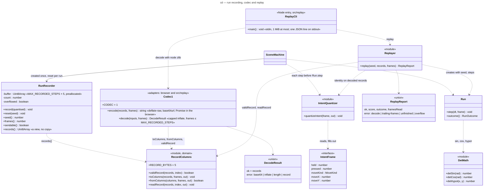

# Class diagram — gameplay — run recording, codec and replay (v0.35)

> **Source specs**: [Game Design Document](../../../design/game-design-document.md) v0.35 §9.1
> (*Send online*, recording)
> **Related ADRs**: ADR-0002 (fixed step), ADR-0009 (intent frame), ADR-0019 (run seed), ADR-0031
> (quantised records, codec 1 columns, deterministic trigonometry, replay CLI)
> **Realizes**: UC9 of [01-use-case](../system/01-use-case.md) (the recording behind it) and the
> homelab verifier's replay (retro-leaderboard UC4)

## Context

What turns a played run into bytes the leaderboard can replay, and back. The live game and the
replay CLI share every class here, so a replay reads exactly what the player's simulation read.

## Diagram

## Notes

- **Record (5 bytes)**: byte 0 bit 0 fire held, bit 1 bomb pressed, bits 2–3 move kind (0 none,
  1 direction, 2 target), other bits 0; then x and y as signed 16-bit little-endian (`direction`
  × 127, `target` × 4). `validRecord` refuses a reserved bit, kind 3, `none` with non-zero x or
  y, a direction outside [-127, 127] or a target outside [-2048, 2047] (ADR-0031 decision 3).
- **Columns (codec 1)**: the flag bytes, then x, then y, each coordinate as its 16-bit
  difference from the previous record's, wrapping; `Codec1` only compresses and encodes them, in
  an adapter (`CompressionStream` in the browser, `node:zlib` in `src/replay`), since the domain
  has no DOM or Node library (ADR-0031 decision 5).
- **Recording stops at the outcome**: `SceneMachine` records the step whose outcome becomes
  `GAME_OVER` or `RUN_CLEARED`, then no more; the replayer returns `trailing-frames` if records
  remain after that step and `unfinished` if they end before it.
- **No allocation in the loop**: the quantised frame and the recorder buffer are created once;
  encoding runs once, in the adapter, after *SEND*; the domain only polls the request handle.
  The replay loop reuses one frame object.
- **Decode caps**: inflate stops at `min(frames, maxFrames) × 5 + 1` bytes and requires exactly
  `frames × 5` and the end of the stream, so a crafted `inputs` can neither exhaust memory nor
  carry extra data (ADR-0031 decision 7).
- **DetMath**: a quarter-wave table of 4 096 steps (4 097 entries) built once from exact
  floating-point operations and a fixed polynomial, linear interpolation; `detHypot` is `Math.sqrt(x * x + y * y)`, correctly
  rounded everywhere. ESLint allows only the exactly specified `Math` members in
  `src/domain/game`, `src/domain/random` and `src/domain/replay` (ADR-0031 decision 10).
