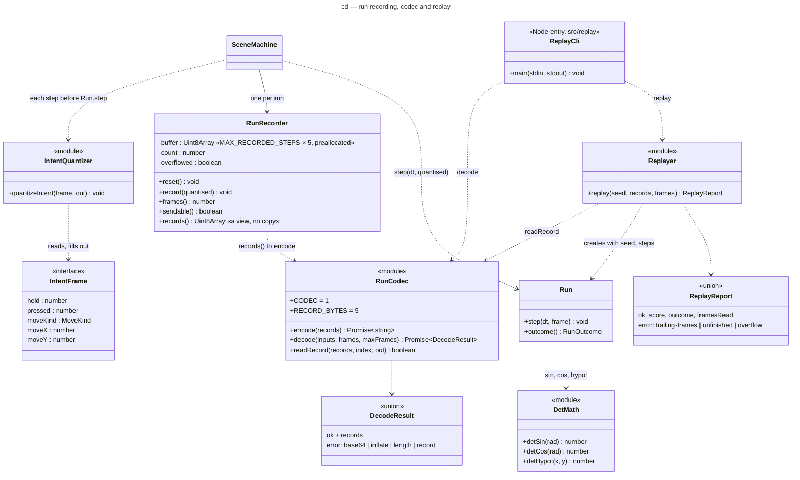

# Class diagram — gameplay — run recording, codec and replay (v0.35)

> **Source specs**: [Game Design Document](../../../design/game-design-document.md) v0.35 §9.1
> (*Send online*, recording)
> **Related ADRs**: ADR-0002 (fixed step), ADR-0009 (intent frame), ADR-0019 (run seed), ADR-0031
> (quantised records, codec 1, deterministic trigonometry, replay CLI)
> **Realizes**: UC9 of [01-use-case](../system/01-use-case.md) (the recording behind it) and the
> homelab verifier's replay (retro-leaderboard UC4)

## Context

What turns a played run into bytes the leaderboard can replay, and back. The live game and the
replay CLI share every class here, so a replay reads exactly what the player's simulation read.

## Diagram

## Notes

- **Record (5 bytes)**: byte 0 bit 0 fire held, bit 1 bomb pressed, bits 2–3 move kind (0 none,
  1 direction, 2 target), other bits 0; then x and y as signed 16-bit little-endian (`direction`
  × 127, `target` × 4). `readRecord` refuses a reserved bit, kind 3 or a direction outside
  [-127, 127] (ADR-0031 decision 3).
- **Recording stops at the outcome**: `SceneMachine` records the step whose outcome becomes
  `GAME_OVER` or `RUN_CLEARED`, then no more; the replayer returns `trailing-frames` if records
  remain after that step and `unfinished` if they end before it.
- **No allocation in the loop**: the quantised frame and the recorder buffer are created once;
  `encode` runs once, on the *Send online* screen, and is the only async step (`CompressionStream`).
  The replay loop reuses one frame object.
- **Decode caps**: inflate stops at `min(frames, maxFrames) × 5` bytes, so a crafted `inputs`
  cannot exhaust memory (ADR-0031 decision 6).
- **DetMath**: a quarter-wave table of 4 096 entries built once from integer arithmetic and a
  fixed polynomial, linear interpolation; `detHypot` is `Math.sqrt(x * x + y * y)`, correctly
  rounded everywhere. ESLint bans the approximated `Math` functions in `src/domain/game` and
  `src/domain/random` (ADR-0031 decision 9).
