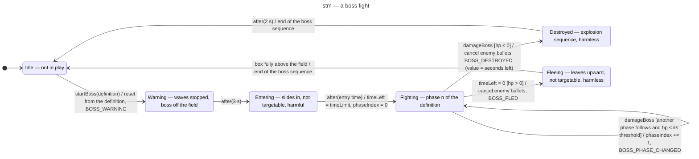

# State machine diagram — gameplay — a boss fight (1.0)

> **Source specs**: [Game Design Document](../../../design/game-design-document.md) v0.10 §3.3,
> §4.5, §6, §6.1, §8, §9.2, §9.4
> **Related ADRs**: ADR-0003 (boss phases as data), ADR-0010 (outcome vs presentation, time
> scale), ADR-0022 (the boss outside the enemy pool, `startBoss`, `damageBoss`)
> **Realizes**: UC1 steps 7–8 and extension 8a of [01-use-case](../system/01-use-case.md);
> `Boss`, `BossState`, `BossDefinition`, `BossPhaseSpec` of [04-class-domain](04-class-domain.md);
> the whole fight in [02-sequence-boss-fight](02-sequence-boss-fight.md)

## Context

The lifecycle of one boss, from the warning to its destruction or its escape. The boss is one
preallocated body in `World`, outside the enemy pool, idle until the level director calls
`startBoss(definition)` at the script's `warningAt` (ADR-0022). Phases are data: a
`BossDefinition` holds 2 or 3 `BossPhaseSpec` (level 3 has 3), each with its HP threshold, its
movement and attack strategies and the part that breaks off. Timers count simulation steps.
Notation: `trigger [guard] / effect`.

## Diagram

## The Cruiser (level 1, GDD v0.10 §6.1, initial)

| | Values |
|---|---|
| Box, HP | 112 × 48; 3 000 tenths (300 level-1 shots); its box never goes below y 80 |
| Warning | 3 s, the boss off the field |
| Entering | from (120, −24) to (120, 56) in 3 s, linear |
| Phase 1 (100 % → 66 %) | `swayMovement({ amplitude: 56, periodS: 8 })` around x 120; `sequenceAttack([[fan], [ring]], 1)` — one volley every 1 s, the groups taking turns, their own `periodS` ignored (ADR-0023): a fan of 5, 15° apart, aimed, 75 px/s, then a ring of 12 at 60 px/s, one volley a second, the first (a fan) 1 s into the fight |
| Phase 2 (from 66 %, 1 980 tenths) | the forward turret breaks off (`brokenPart`, debris); `swayMovement({ amplitude: 72, periodS: 6 })`; `sequenceAttack([[ring], [ring, triple]], 1.5)` with `ring` = `ringAttack({ count: 16, speed: 60, rotateDeg: 11.25 })` and `triple` = `fanAttack({ count: 3, spreadDeg: 15, speed: 75 })` — one volley every 1.5 s, the ring on every volley (turned by 11.25° × the volley index, so by the number of rings fired), the triple on every second one: the first ring 1.5 s and the first triple 3 s after the change, `Body.volleys` and `fireTimer` restarted at the threshold, `age` at the movement swap (ADR-0023) |
| Timer, bonus | 90 s; 10 000 + 100 × seconds left, flat |
| Fleeing | straight up at 60 px/s |
| Destroyed | 2 s, then `LEVEL_CLEARED` |

## Notes

- **Phases are one data-driven state**: the self-transition repeats while the guard holds, so a
  single large hit (a bomb) that crosses two thresholds advances two phases in the same step,
  publishes one `BOSS_PHASE_CHANGED` per crossed threshold and breaks every part.
- **No damage before `Fighting`** (GDD v0.10 §6): shots pass through the boss in `Warning`,
  `Entering`, `Destroyed` and `Fleeing` (collision pass 1 includes it only in `Fighting`), and a
  bomb damages it only in `Fighting` — in `Warning` and `Entering` the bomb still cancels the
  bullets and hits the enemies on the field, but not the boss. Its body hits the player in
  `Entering` and `Fighting` (GDD v0.3 §5.2); in `Destroyed` and `Fleeing` it is harmless, so
  nothing can kill the player during the end of the fight (GDD v0.4 §6). In `Warning` it is off
  the field and tested by no pass.
- **The 90 s timer runs only in `Fighting`**, is frozen by the pause and counts steps, so hit-stop
  and slow motion never change it (ADR-0010). If HP and timer reach 0 in the same step, the
  destruction wins. The HUD shows `secondsLeft()` — the steps left rounded up — from `Entering`
  (90) until the `Destroyed` or `Fleeing` sequence ends.
- **Phase change and sway continuity** (ADR-0023): at the HP threshold the attack switches at once
  and `fireTimer` and `volleys` restart (the first ring 1.5 s later, counted from 0); the movement
  keeps the old sway until `x − 120` changes sign, then the boss swaps the movement, restarts
  `age` and sets `mirror` to its direction, so the new sway starts at x 120 in the same direction
  and the body does not visibly jump (GDD v0.10 §6.1).
- **End of the fight** (GDD v0.4 §6): enemy bullets are cancelled on both endings, so the player
  cannot die during the sequence. During `Destroyed` the ship keeps its control; its bullets are
  spent when the level ends. The waves stop at `warningAt`, and a level script must leave the field
  empty by the time the WARNING starts (the level simulation asserts it): the 4 s load rule alone
  does not, since a Heavy stays about 14 s, and an enemy still alive would keep firing and hurting
  during the end of the fight, which this guarantee forbids.
- **Score and outcome**: `BOSS_DESTROYED` carries the seconds left; `ScoreKeeper` adds 10 000 +
  100 × seconds (GDD §6; `BossTuning`, ADR-0023), flat, outside the chain; hits score 0; `BOSS_FLED` scores nothing.
  `LEVEL_CLEARED` (`value` = bombs left) is published by `Run` at step 8 when the sequence ends,
  once, never while the ship is `Dead`;
  `LevelTally` records the bombs left and `ScoreKeeper` adds the tally (GDD §8); the run outcome
  becomes `LEVEL_CLEARED`, or `RUN_CLEARED` after the last level of the list — level 1 in the
  vertical slice (ADR-0022). A level end is deferred while the player is `Dead`
  (04-class-domain, step 8).
- **Presentation** reads the boss view of the snapshot (ADR-0022 decision 8): the WARNING banner
  ("WARNING", FR "ATTENTION") for the 3 s of `Warning`, two blinks under 3 Hz, steady when the
  blink effect is off, shown in `Playing` only (never under GAME OVER, the pause icon or the
  count-in digit, which share its centre; F-2b); the HP bar and the seconds, from `Entering` to
  the end of the sequence (the boss is `Idle` again at `Results`); the debris on `BOSS_PHASE_CHANGED`; the boss explosion and the **slow motion** on
  `BOSS_DESTROYED` — half speed for 0.5 s of wall time, a time scale in the loop behind
  `EffectSettings.slowMotion`; it never changes the 2 s of the dying sequence in steps.
- **Silence** (GDD §6): the 3 s of silence and the boss track wait for audio; until then the
  warning is visual only.
