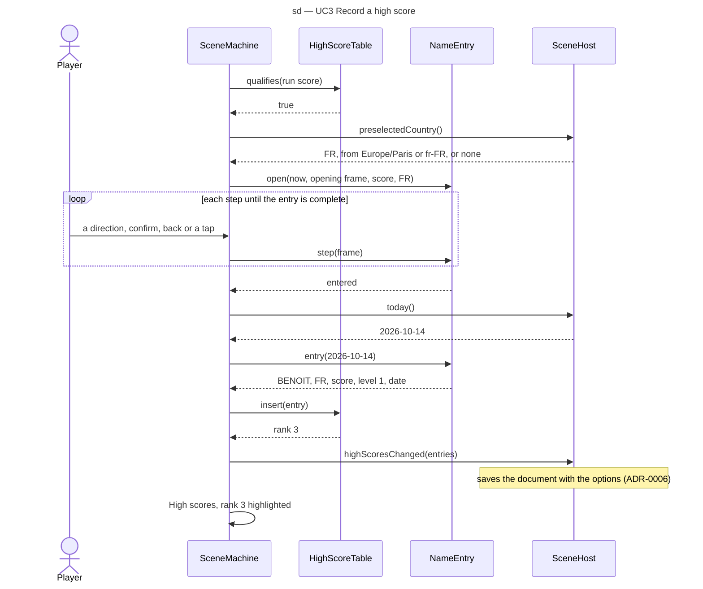

# Sequence diagram — meta — recording a high score (G2)

> **Source specs**: [Game Design Document](../../../design/game-design-document.md) v0.16 §9.1
> (the letter grid, the high-score table, the Ending card), §9.8
> **Related ADRs**: ADR-0006 (save document), ADR-0021 (the entry, the country preselection)
> **Realizes**: UC3 of [01-use-case](../system/01-use-case.md); the G2 states of
> [05-state-scenes](05-state-scenes.md); `NameEntry`, `LetterGrid` and `HighScoreTable` of
> [04-class-menus](04-class-menus.md)

## Context

How a finished run's score reaches the table and the save: it crosses the scene machine, the
name entry, the table and the host. It does not cover the grid's moves (a menu, like the others).

## Diagram

## Notes

- The browser time zone and language are read once at startup by the composition root (the ADR-0009 snapshot);
  the domain keeps the code only if it is in `COUNTRY_CODES`.
- `preselectedCountry` reads the browser time zone through the generated zone → country table,
  else the region of the browser's first language (ADR-0021 decision 4 and its 2026-10-26 amendment); nothing else is read or inferred, and the country is stored only once confirmed.
- The table and the entries are domain data; the host only stores them (`SaveStore`), which keeps
  the stored top 10 written back with every option change (G1a-1).
- When storage is unavailable the table still shows the entry for the session (UC3 3a).
