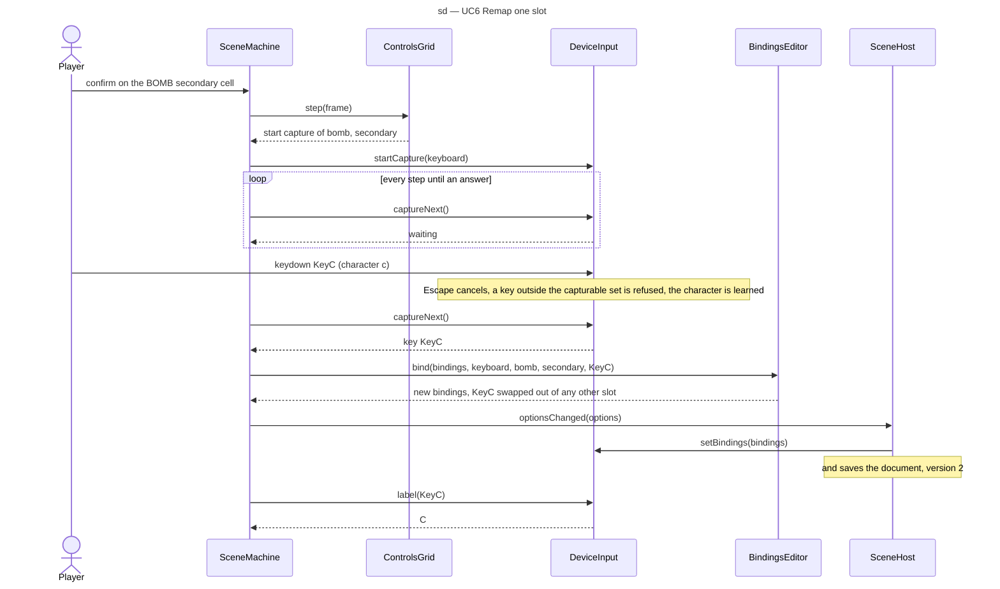

# Sequence diagram — meta — capturing a new key or button (G1b)

> **Source specs**: [Game Design Document](../../../design/game-design-document.md) v0.15 §4.2
> (the controls screen)
> **Related ADRs**: ADR-0006 (save document), ADR-0009 (`InputPort`, `BindingCapture`),
> ADR-0012 (binding shapes), ADR-0015 decision 6 (fixed keys)
> **Realizes**: UC6 of [01-use-case](../system/01-use-case.md); the `Capturing` state of
> [05-state-scenes](05-state-scenes.md); `ControlsGrid`, `BindingsEditor` and `KeyLabels` of
> [04-class-menus](04-class-menus.md)

## Context

How one slot is rebound: the capture crosses the scene machine, the input port and its device
modules, then the save. It does not cover restore defaults (a plain confirmation and reset).

## Diagram

## Notes

- The press that starts the capture is not the captured input: the input port only answers a
  key or button pressed after `startCapture`.
- While waiting, and in the step that receives the answer, the scene machine reads no menu action
  from the frame (`back` and `Pause` are not acted on), so a gamepad `B` or `Start` can be bound
  and `Escape` never also leaves the screen; the keyboard's `Escape` cancels through
  `captureNext`, and a tap, leaving the scene or an automatic pause trigger calls `cancelCapture`.
- When `bind` refuses (the exchange would leave an intent without a key), the scene machine
  calls `startCapture` again: the wait goes on.
- `label` is read at each draw, never stored: a character learned later corrects the label at
  once.
