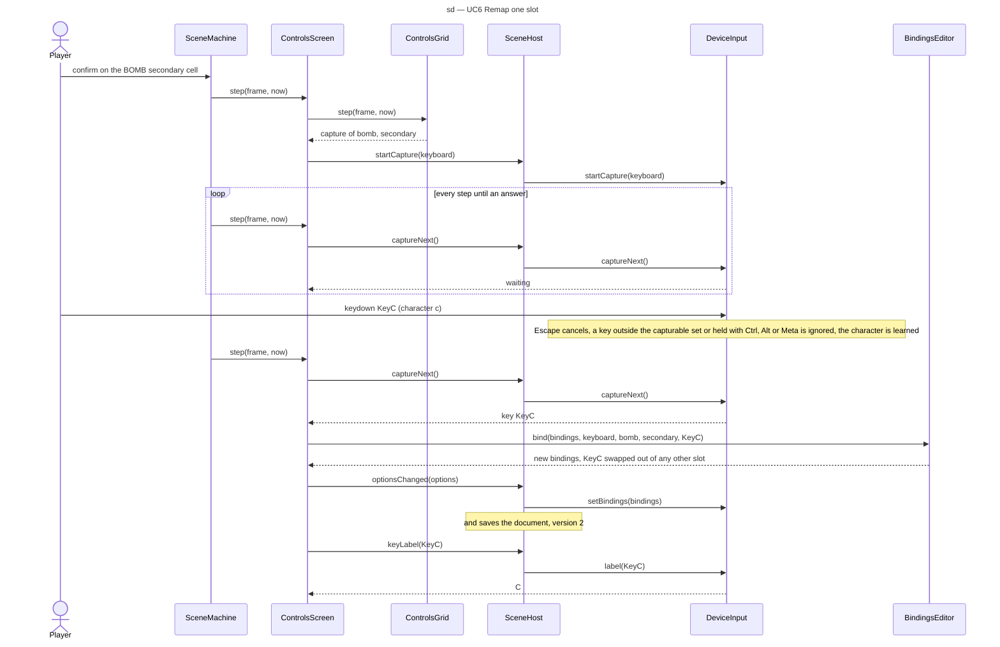

# Sequence diagram — meta — capturing a new key or button (G1b)

> **Source specs**: [Game Design Document](../../../design/game-design-document.md) v0.15 §4.2
> (the controls screen)
> **Related ADRs**: ADR-0006 (save document), ADR-0009 (`InputPort`, `BindingCapture`),
> ADR-0012 (binding shapes), ADR-0015 decision 6 (fixed keys)
> **Realizes**: UC6 of [01-use-case](../system/01-use-case.md); the `Capturing` state of
> [05-state-scenes](05-state-scenes.md); `ControlsScreen`, `ControlsGrid`, `BindingsEditor` and
> `KeyLabels` of
> [04-class-menus](04-class-menus.md)

## Context

How one slot is rebound: the scene machine routes the step to `ControlsScreen`, which owns the
grid and the capture; the capture goes through `SceneHost`, never straight to the input port
(owner, 2026-10-15, decision A2), then the save. It does not cover restore defaults (a plain
confirmation and reset).

## Diagram

## Notes

- The press that starts the capture is not the captured input: the input port only answers a
  key or button pressed after `startCapture`.
- `SceneHost` is the composition root's (`src/app/main.ts`): its `startCapture`, `captureNext`,
  `cancelCapture` and `keyLabel` forward to the input port, and its `optionsChanged` saves and
  calls `setBindings` only when the bindings object changed.
- While waiting, and in the step that receives the answer, `ControlsScreen` reads no menu action
  from the frame (`back` and `Pause` are not acted on), so a gamepad `B` or `Start` can be bound
  and `Escape` never also leaves the screen; the keyboard's `Escape` cancels through
  `captureNext`, and a tap, leaving the scene or an automatic pause trigger calls `cancelCapture`.
- When `bind` refuses (it returns `undefined`: the exchange would leave an intent without a key),
  `ControlsScreen` calls `startCapture` again: the wait goes on.
- A key pressed with Ctrl, Alt or Cmd/Meta held is ignored by the capture and keeps its browser
  action (`isShortcut` in `src/adapters/input/device-input.ts`); the Ctrl and Alt keys themselves
  stay capturable (owner, 2026-10-15, decision C3). The gamepad capture reads the standard
  mapping's buttons 0 to 16 and refuses 16, the system's home button.
- `keyLabel` is read at each draw, never stored: a character learned later corrects the label at
  once.
