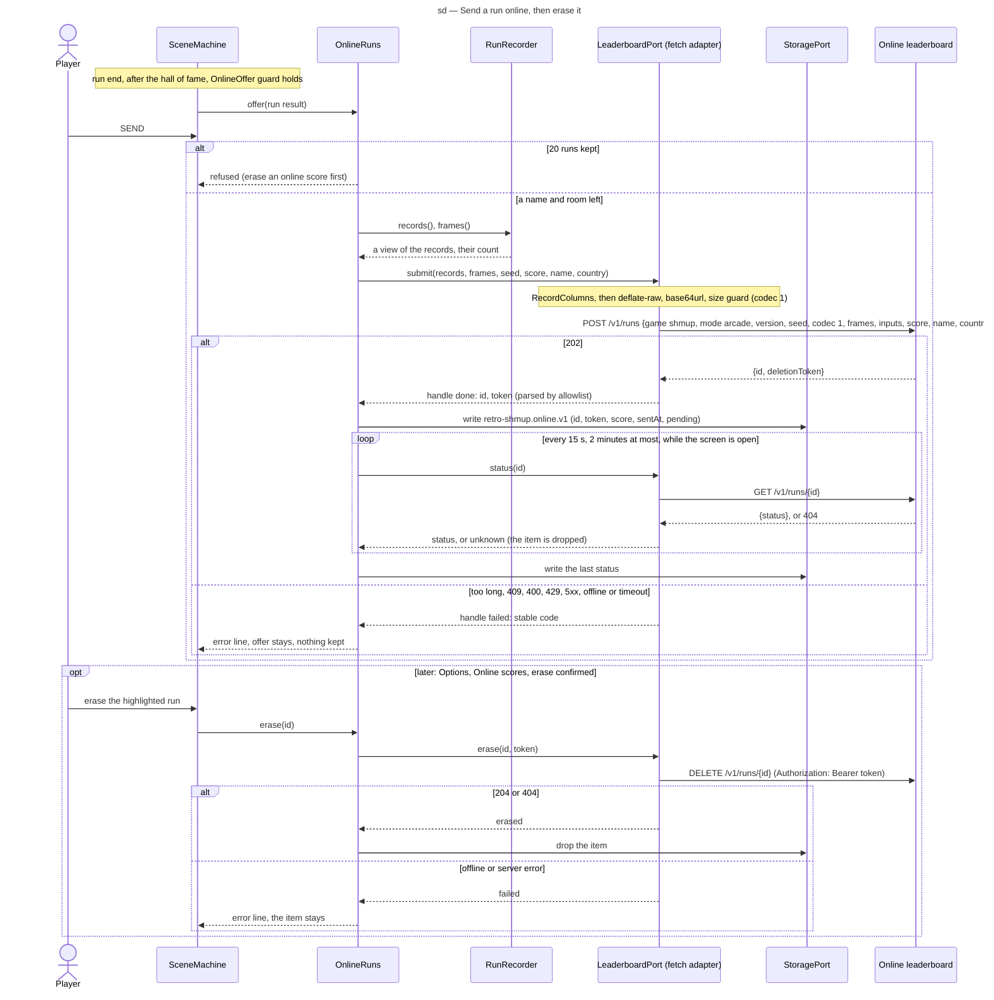

# Sequence diagram — meta — send a run online and erase it (v0.35)

> **Source specs**: [Game Design Document](../../../design/game-design-document.md) v0.35 §9.1
> (*Send online*), §9.3 (*Online scores*), §9.8
> **Related ADRs**: ADR-0006 (untrusted stored data), ADR-0027 (new-tab gesture rule), ADR-0031
> (recording, codec, sending, kept runs); retro-leaderboard ADR-0001, ADR-0003, ADR-0004
> **Realizes**: UC9 and UC10 of [01-use-case](../system/01-use-case.md); the online states of
> [05-state-scenes](05-state-scenes.md)

## Context

The game's only network exchange. The recording itself happens step by step during the run
([04-class-run-recording](../gameplay/04-class-run-recording.md)); this diagram starts at the run
end. The domain never awaits: it starts a request through `LeaderboardPort` and reads the
handle's result on a later step.

## Diagram

## Notes

- **Consent**: nothing is built or sent before *SEND*; the cursor opens on *NOT NOW*. *PRIVACY*
  opens `GET /privacy` in a new tab by the feedback form's gesture rule (ADR-0027).
- **No retry of a send**: a failed `POST` keeps nothing; the player may press *SEND* again
  (a second identical run that did reach the server answers `409 duplicate-run`).
- **The token never leaves the browser except in the `DELETE` header**; it is never logged,
  never put in a URL and never dropped to make room (GDD v0.35 §9.8).
- **Polling stops** when the player leaves the screen or after 2 minutes; *Online scores* asks
  again, one run at a time, only for runs still `pending`.
