# Class diagram — meta — menus, options and the save document (G1a)

> **Source specs**: [Game Design Document](../../../design/game-design-document.md) v0.13 and v0.14 §9.1
> (menus; v0.25: the row height per menu, #95; v0.14: leaving a menu frees the movement), §9.3 (options and their layout), §9.4, §9.8
> **Related ADRs**: ADR-0006 (save document, `StoragePort`), ADR-0009 (fullscreen at the next
> gesture), ADR-0015 (the last device used), ADR-0020 decision 4 (the autofire option), ADR-0021
> (the high-score entry)
> **Realizes**: UC5 of [01-use-case](../system/01-use-case.md); the `Options` and `Visual
> effects` states of [05-state-scenes](05-state-scenes.md)

## Context

The types the screens brick's first part (G1a) adds outside the simulation: one menu model for
every menu, the options and their save. It does not cover the remap rows (G1b), the high-score
table (G2) or the volumes (G3).

## Diagram

```mermaid
---
title: cd — menus, options and the save document
---
classDiagram
  class Menu~Id~ {
    +rows: readonly Id[]
    +top: number
    +rowHeight: number
    +highlighted: number
    +lastSideways: number
    -flips: row to boolean, constructor
    +headerGap: number
    +constructor(rows, options?: flips and headerGap)
    +reset(now: number, opening: IntentFrame) void
    +ignore(frame: IntentFrame) void
    +rowAt(y: number) number
    +step(frame: IntentFrame, now: number) Id | undefined
  }
  class OpenableMenu {
    <<interface>>
    +reset(now: number, opening: IntentFrame) void
  }
  class MenuView {
    <<interface>>
    +rows: readonly MessageKey[]
    +top: number
    +rowHeight: number
    +highlighted: number
  }
  class MenuScreen {
    <<interface>>
    +menu: MenuView
    +header?: key and font, title or menu
    +note?: MessageKey, one line above the rows (the feedback offer)
    +value?(row: MessageKey) MessageKey | undefined
  }
  class ControlsView {
    <<interface>>
    presentation/menu-layout, with CONTROLS_COLUMNS and SlotColumn 0 or 1
  }
  class ControlsScreen {
    +grid: ControlsGrid
    +device: keyboard | gamepad
    +capturing: boolean
    -pending: intent and slot | undefined
    +open(now, opening) void
    +step(frame, now) back | restore | undefined
    +restoreDefaults() void
    +cell(row, column: SlotColumn) string
  }
  class HighScoresView {
    <<interface>>
    +rows: readonly HighScoreRow[]
    +highlighted: number
  }
  class HighScoresScreen {
    +rows: readonly HighScoreRow[]
    +highlighted: number
    +open(table: HighScoreTable, highlighted: number) void
    +step(frame) boolean
  }
  class SceneHost {
    <<interface>>
    +optionsChanged(options: Options) void
    +releaseMovement() void
    +startCapture(device: keyboard | gamepad) void
    +captureNext() BindingCapture
    +cancelCapture() void
    +keyLabel(code: string) string
    +countryOfLanguage() string | undefined
    +today() string
    +highScoresChanged(entries) void
  }
  class InputPort {
    <<interface>>
    +setFullscreenWanted(wanted: boolean) void
    +setAutofire(on: boolean) void
    +releaseMovement() void
    +setBindings(bindings: Bindings) void
    +startCapture(device: keyboard | gamepad) void
    +captureNext() BindingCapture
    +cancelCapture() void
    +label(code: string) string
  }
  class ControlsGrid {
    +row: number
    +column: 0 | 1
    +capturing: boolean
    +step(frame, now) GridAction | undefined
  }
  class BindingsEditor {
    <<functions>>
    +bind(bindings, device, intent, slot, input) Bindings | undefined
    +restore(bindings, device) Bindings
  }
  class ButtonNames {
    <<table>>
    input-names BUTTON_NAMES behind buttonName and keyName, index 0 to 15
  }
  class Bindings {
    <<interface>>
    keyboard and gamepad slots per remappable intent, ADR-0012
  }
  class KeyLabels {
    adapter: learned code to character, layout map, fixed names
  }
  class SceneMachine {
    -options: LiveOptions
    -menuScreens: table of menu scenes
    -optionsTouch: boolean
    -table: HighScoreTable
    -handlers: Record of Scene to SceneHandler, built once
    -sceneSteps: number, steps since the scene was entered
    -lockLeft: number
    +constructor(..., host, highScores)
    -openMenu(scene, frame) void
    -screenOf(scene) MenuScene | undefined
  }
  class FeedbackFlow {
    +enabled: boolean
    +blocked: boolean, 2 s after a refused tab
    +step(at: ArmedAt, context) LinkOutcome
    +disarm() void
    +block() void
  }
  class LinkPort {
    <<interface>>
    +arm(link: ArmedLink | undefined) void
    +takeOutcome() opened | refused | none
  }
  class SceneHandler {
    <<interface>>
    +step(dt: number, frame: IntentFrame) void
    +overlay() void
  }
  class LiveOptions {
    +value(row: MessageKey) MessageKey | undefined
    +apply(row: MessageKey) boolean
  }
  class IntentFrame {
    <<interface>>
    +tapRegion, tapX, tapY
    +releaseRegion, releaseX, releaseY
    +hovered, hoverX, hoverY
    +active
  }
  class Options {
    <<interface>>
    +effects: EffectSettings
    +autofire: boolean
    +language: Language
    +fullscreen: boolean
  }
  class EffectSettings {
    <<interface>>
    one boolean per effect of GDD §9.4
  }
  class SaveDocument {
    <<interface>>
    +version: 2
    +options: Options
    +highScores: readonly HighScoreEntry[]
  }
  class HighScoreEntry {
    <<interface>>
    +name: string
    +country?: string
    +score: number
    +level: 1 | 2 | 3
    +date: string, YYYY-MM-DD
  }
  class HighScoreTable {
    +entries: readonly HighScoreEntry[]
    +qualifies(score: number) boolean
    +insert(entry: HighScoreEntry) number
  }
  class PressGuard {
    +open(now) void
    +cancel() void
    +press(target, now) void
    +release(target, now) boolean
  }
  class GridCell {
    +action: Action
    +text: string
    +label?: MessageKey
    +row: number
    +column: number
    +span: number
  }
  class LetterGridView {
    <<interface>>
    +cells: readonly GridCell[]
    +cursor: number
    +available(index) boolean
  }
  class LetterGrid~Action~ {
    +cells: readonly GridCell[]
    +cursor: number, read-only
    +constructor(cells, available?)
    +available(index) boolean
    +reset(now, opening, start = 0) void
    +cellAt(x, y) number
    +step(frame, now) GridCell | undefined
    +settle() void
  }
  class NameEntryView {
    <<interface>>
    +heading: MessageKey
    +slotCount: number
    +nextSlot: number
    +slot(index) string
    +grid: LetterGridView
  }
  class NameEntry {
    +name: string
    +open(now, opening, score, country) void
    +step(frame, now) skipped | entered | undefined
    +entry(date) HighScoreEntry
  }
  class CountryChoice {
    +choice: string, a code or none
    +knownCode: string, cached on input, v0.27
    +open(now, opening, preselected) void
    +step(frame, now) chosen | cancelled | undefined
  }
  class SaveStore {
    +load() Options, parseBindings and parseHighScores
    +highScores: readonly HighScoreEntry[]
    +saveOptions(options: Options) boolean
    +saveHighScores(entries: readonly HighScoreEntry[]) boolean
  }
  class StoragePort {
    <<interface>>
    +read(key: string) string | null
    +write(key: string, value: string) boolean
  }
  class LocalStorageStore {
    adapter, try/catch on every call
  }

  SceneMachine ..> SceneHandler : handlers table, one entry per Scene
  SceneMachine *-- "7" Menu
  SceneMachine --> SceneHost : each change, leaving for play
  SceneMachine *-- ControlsScreen
  SceneMachine *-- HighScoresScreen
  ControlsScreen ..|> ControlsView
  ControlsScreen *-- ControlsGrid
  ControlsScreen ..> BindingsEditor : bind, restore
  ControlsScreen ..> ButtonNames : slot names
  ControlsScreen --> SceneHost : capture, keyLabel, optionsChanged
  HighScoresScreen ..|> HighScoresView
  HighScoresScreen ..> HighScoreTable : rows formatted on open
  Menu ..|> OpenableMenu
  OpenableMenu --|> MenuView
  SceneMachine *-- LiveOptions
  LiveOptions ..|> Options
  KeyLabels ..> InputPort : behind label()
  Options --> Bindings : v0.15
  Menu ..> IntentFrame : tap, release, hover
  MenuScreen --> MenuView
  Options *-- EffectSettings
  SaveDocument *-- Options
  SaveStore ..> SaveDocument : load parses, never throws
  SaveDocument *-- "0..10" HighScoreEntry
  HighScoreTable o-- "0..10" HighScoreEntry
  NameEntry *-- LetterGrid
  CountryChoice *-- LetterGrid
  CountryChoice ..|> NameEntryView
  SceneMachine *-- CountryChoice
  LiveOptions ..> CountryChoice : setCountry on chosen
  NameEntry ..|> NameEntryView
  NameEntryView --> LetterGridView
  LetterGrid ..|> LetterGridView
  LetterGrid *-- "1..*" GridCell
  LetterGrid *-- PressGuard
  Menu *-- PressGuard
  NameEntry ..> HighScoreEntry : builds with the host's date
  SceneMachine *-- NameEntry
  SceneMachine *-- HighScoreTable
  SaveStore --> StoragePort
  LocalStorageStore ..|> StoragePort
  SceneHost ..> SaveStore : composition root
  SceneHost ..> InputPort : composition root
  SceneMachine --> FeedbackFlow : title row, offer, gesture prompt
  FeedbackFlow --> LinkPort : arms the row's band and keys, ADR-0027
```

## Notes

- **One menu model** for the title, the pause, Confirm quit, the options (full, and the touch
  variant without *Controls*), the visual effects and Confirm restore (seven menus, built once;
  owner, 2026-10-15, decision A4): the `SceneMachine` builds each menu's rows from data, so a later row
  (high scores, controls, audio) is a data addition. A row whose screen does not exist yet is not
  in the list. Rows are message keys; there is no row-kind class (G1a-3 design, KISS): a row is a
  switch or a choice only because its screen's `value(row)` gives it a value (*ON* / *OFF*,
  *ENGLISH* / *FRANCAIS*), and the scene machine knows what activating it does. A new left or
  right direction on a highlighted row activates it like `Confirm`, detected on the edge like up
  and down (GDD v0.14 §9.1): every value has two states.
- **Runtime options and `SceneHost`** (G1a-3): `LiveOptions` (`src/domain/options.ts`) holds the
  options while the game runs and knows what each row shows (`value`) and what activating it
  changes (`apply`); the scene machine only routes (G1a-3 anti-pattern review: it no longer owns
  the option rules). The presenter reads the same `EffectSettings` object, so a switch applies at
  the next frame; the language is read at each draw. After each change it calls `SceneHost.optionsChanged`, and on
  every exit from a menu towards play (*Play*, *Resume*, `back` and the pause button in the
  pause) `SceneHost.releaseMovement` (GDD v0.14 §9.1). The composition root implements the host: it saves through `SaveStore` and forwards
  autofire, fullscreen and the movement release to the `InputPort` — so the domain never sees
  the browser and the scene machine never sees storage.
- **`InputPort` gains `setAutofire` and `releaseMovement`** (ADR-0009 contract, G1a-3):
  `setAutofire` is ADR-0020 decision 4's option. `releaseMovement` drops the movement owner only
  if it is the mouse or touch (it sets the arbitration's `clearedAt` in that case); unlike a lost
  focus (ADR-0015 decision 5) it clears no held button and queues no pause, and a keyboard or
  gamepad owner keeps the ship, a held direction included.
- **Options and Visual effects are reached from the title and from the pause**: four scenes
  sharing two menus (meta/05-state-scenes), so `back` returns to the right parent.
- **The press and release rule lives in `Menu`** (built in G1a-2; the design's separate
  `PointerPress` was folded in, one caller only): a press within 150 ms of the last activation on
  the same row is ignored (a bouncing or doubled touch contact), and a release activates only over
  the row its press started on (GDD v0.13 §9.1). `now` is the scene machine's step count, never
  wall time. Rows are message keys, so a menu draws from the catalogue without building strings.
- **`IntentFrame` extension (ADR-0009 contract, G1a-2)**: besides the tap on press, the frame
  carries the release (`releaseRegion`, `releaseX`, `releaseY`: a lifted finger or the left
  button going up, none for a cancelled finger) and the mouse hover (`hovered`, `hoverX`,
  `hoverY`, play-field pixels, only when the cursor reaches a new field point).
- **`SaveStore` owns the schema rules, `StoragePort` only the strings** (ADR-0006 decision 3).
  `load()` falls back to the defaults on a missing, unreadable or unknown document, and
  `prefers-reduced-motion` presets the effect switches on a first launch only (GDD §9.3).
  `saveOptions` writes the whole document once per change, never inside the fixed step
  (ADR-0006 decision 6); `false` means the session goes on without saving.
- **`EffectSettings`** is the presentation's existing switch set (six switches today: blink,
  hit flash, explosions with the debris, shake, bomb flash, slow motion); the visual-effects
  screen lists exactly its switches, and an effect added later brings its switch and row.
- **`highScores`** stays an empty list until the hall of fame (G2) fills it. The options shape
  of G1a is version 1; the remap (G1b) and the volumes (G3) change it, so each bumps `version`
  with a migration function, as ADR-0006 decision 4 requires.
- **Layering (G1a-2 review)**: `Menu` (scenes) depends on `presentation/menu-layout` for the row
  height and centring; presentation draws a `MenuView` / `MenuScreen` and never imports scenes.
  The scene machine keeps one table of menu scenes (menu, optional header) and one
  `openMenu(scene, frame)`, so a new menu screen is one entry plus its step method. `Options` and
  `EffectSettings` live in `src/domain/options.ts`, shared by the presenter, the save store and
  the options screen.
- `Language`, `MessageKey` and `HighScoreEntry` are the existing catalogue and save types.
- **Controls (G1b, GDD v0.15 §4.2)**: `ControlsGrid` is the two-column menu of the controls
  screen (seven intent rows with two slot cells, then *Restore defaults* and *Back*): up and
  down change the row, left and right the column, `confirm` or a tap on a cell starts the
  capture; it shares `Menu`'s press, release and opening-guard rules. `BindingsEditor` is pure
  domain: `bind` puts the captured input in the slot and exchanges it with the slot that held it
  on the same device; when that would empty another intent's primary, its secondary moves up,
  and when it has none `bind` refuses (the capture goes on), so no intent is left unbound;
  `restore` resets one device. `ControlsScreen`
  asks `SceneHost` to `startCapture`, polls `captureNext` each step until `key`, `button` or
  `cancelled` (the keyboard's `Escape`, the gamepad's 5 s), and cancels on a tap; leaving or an
  automatic pause trigger cancels too; the answering step reads no menu action. The capture answers
  only the edited device and only the capturable set of GDD v0.15 §4.2 (a closed list; refused
  keys leave it waiting), and the adapter prevents every key's default meanwhile but `Escape`'s.
  Gamepad labels come from the domain's `ButtonNames` table (the private `BUTTON_NAMES` behind
  `buttonName()` and `keyName()` in `src/domain/input/input-names.ts`; the gamepad capture reads
  the buttons 0 to 16 and refuses 16, the system's home button). A key pressed with Ctrl, Alt or
  Cmd/Meta held is ignored in play and in capture and keeps its browser action (`isShortcut`,
  `src/adapters/input/device-input.ts`); the Ctrl and Alt keys themselves, whose own keydown
  carries their flag, are not shortcuts and stay capturable (owner, 2026-10-15, decision C3).
  Keyboard labels are split by language (G1b-2): `InputPort.label` (reached through
  `SceneHost.keyLabel`) answers only the character a letter or digit key prints
  (`KeyLabels` in the adapter: learned from the session's key events, then the layout map turned
  to capitals once, then US; `''` for any other key), and the domain names the other keys through
  the catalogue (*SPACE* / *ESPACE*, *SHIFT L* / *MAJ G*, the arrow glyphs, *NUM 0*…) with the
  screen (G1b-3).
- **Screens own their state, the scene machine routes** (owner, 2026-10-15, decision A1):
  `ControlsScreen` (`src/domain/scenes/controls-screen.ts`) owns the grid, the edited device, the
  pending capture and the cell texts, implements `ControlsView` (`CONTROLS_COLUMNS`,
  `ControlsView` and `SlotColumn` in `presentation/menu-layout.ts`), calls `bind` itself and
  hands the scene machine only `back` and `restore`. `HighScoresScreen`
  (`src/domain/scenes/high-scores-screen.ts`) formats its ten `HighScoreRow`s once on open and
  implements `HighScoresView` (both in `presentation/overlays.ts`); `back`, `confirm` or a tap
  started on the screen leaves it.
- **The capture goes through `SceneHost`** (decision A2): `startCapture`, `captureNext`,
  `cancelCapture` and `keyLabel` (`src/domain/scenes/scene-host.ts`), never straight to
  `InputPort`; the composition root's host forwards to the input port, and its `optionsChanged`
  saves and pushes new bindings with `setBindings`.
- **The stored top 10** (decision A3) reaches the scene machine as its constructor parameter
  `highScores` (`main.ts` passes `save.highScores`), built into a `HighScoreTable`.
  `SceneHost.countryOfLanguage`, `today` and `highScoresChanged`, `NameEntry` and `LetterGrid`
  are built (G2-3).
- **Menu members** (decision A4): `Menu` implements `OpenableMenu` (`reset(now, opening)`, what a
  scene needs to open and draw any menu); `ignore(frame)` is the title lock's step; `lastSideways`
  gives the controls grid its column; the constructor's `flips` predicate says which rows left and
  right flip. `MenuScreen` has an optional `header {key, font}` and an optional `value`. The scene
  machine's `screenOf(scene)` returns the table's screen, or the options without *Controls* when
  `optionsTouch` (touch used last, frozen when the options open in `openMenu(scene, frame)`).
- **Where the binding rules live (G1b-1)**: `REMAPPABLE_INTENTS` in the input port (the
  `RemappableIntent` type derives from it); `domain/input/capturable.ts` the capturable set;
  `domain/input/bindings-editor.ts` `bind` and `restore` (which also refuse an input outside the
  set); `domain/input/parse-bindings.ts` the save document's bindings parsing, so the save store
  only versions and migrates the document.
- **Save version 2**: `Options` gains `bindings`; version 1 migrates by adding the defaults
  (ADR-0006 decision 4); the bindings are parsed by allowlist (every key code from the capturable
  set, every index from 0 to 15, primary present, no duplicate), a failing device getting its
  defaults back.
- **Hall of fame (G2, GDD v0.16 §9.1)**: `LetterGrid` is the two-dimensional menu of the name
  entry (cells of 30 × 32 px since v0.26, eight to a row; the directions move a wrapping cursor, `confirm` or
  a release over the pressed cell picks it, with `Menu`'s guards); its cells are characters or
  the actions *SPACE*, *DEL*, *OK*, *SKIP* and *NONE*. `NameEntry` builds the name (8 at most,
  `back` deletes; on *OK* trimmed; *SKIP*, or an empty or all-space name, records nothing) (the country step moved to `CountryChoice` in v0.26), and builds the `HighScoreEntry` (`entry(date)`) once `step` returns
  `entered`, with the score given to `open` and the date the host gives (`SceneHost.today()`,
  the domain reads no clock); the level stored is 1, the slice having one level (owner,
  2026-10-15, ADR-0022 decision 9).
- **Attract mode (G2-3b, GDD v0.16 §9.1)**: `IntentFrame.active` (ADR-0009, amended) says the
  step saw any physical input; `DeviceInput` fills it from the browser events (any `keydown`, a
  key still down — `KeyboardModule.anyDown`, held shortcut keys tracked apart — any pointer event
  on the page, a pad button or a stick tilted enough to move the ship — `GamepadModule.anyHeld`),
  never from the intent bits, so the automatic pause triggers are not inputs. On `Title` the
  scene timer `sceneSteps` counts the steps without input (reset to 0 by an active frame;
  `SceneTuning.attractIdleSeconds` 10), then `openAttract` enters the `Attract` scene, which
  reuses `HighScoresScreen` (`open(table, -1)`) and the High scores overlay, and leaves on any
  active frame or after `SceneTuning.attractSeconds` (6) through `openMenu`, with no lock.
- **Country first (v0.26, ADR-0027 decision 6)**: `CountryChoice` is the former country step of
  `NameEntry`, a scene of its own: opened before the first run while `Options.country` is absent
  (`StartCountry`, preselected by `SceneHost.countryOfLanguage`), and from the options' *Country*
  row (`TitleCountry`, `PauseCountry`, preselected with the saved code). `back` on an empty code
  returns `cancelled`. `Options.country` is absent, `none` or a code of `COUNTRY_CODES`; the
  options row shows the code, or `--`, as a `TextValue`. `NameEntry` has the name only and copies
  the saved code into the entry. The grid is 32 px tall per row from y 104 (#115).
- **Flags (v0.27, ADR-0028, #125)**: the overlays that draw a country code — the options'
  *Country* `TextValue`, `drawHighScores` (code at x 104, `drawFlag` at x 122) and the country
  choice's slots once `CountryChoice.knownCode` is not empty — call
  `RenderPort.drawFlag(code, codeRight + 2, textTop - 1)` right after the code; a `false` return
  leaves the code alone. The options row and the slots centre the text plus 18 px as one line.
  `CountryChoice.knownCode` is a string cached when a letter is typed or deleted: the code once
  complete and in `COUNTRY_CODES`, else `''`; never `choice`, whose `join` would allocate every
  frame. No save field changes: the flag is presentation only.
- **Name entry, as built (G2-3, owner-approved 2026-10-15)**: the cells are data (`NAME_CELLS`,
  `COUNTRY_CELLS`, characters eight to a row, then the actions; an action never straddles two
  rows). `PressGuard` (`src/domain/scenes/menu-input.ts`, with the direction thresholds) holds the
  press, release and guard rules `Menu` and `LetterGrid` share. A mostly-vertical tilt moves up
  or down, any other tilt sideways; left and right wrap within the row, up and down over the rows
  in the cursor's column, skipping empty places and a hidden *OK*. A hover or a picking release
  moves the cursor and its column to the pointer. When *OK* disappears under the cursor
  (`settle`), the cursor steps to the previous cell of its row. The country choice opens on *OK* when
  the preselected code is known, else on `A`, and *NONE* ends at once. The view interfaces (`NameEntryView`, `LetterGridView`,
  `GridCell`) live in `presentation/menu-layout.ts` with the grid geometry; `GridAction` is the
  scene's (`name-entry.ts`). `HighScoreTable` keeps ten entries, best
  first, a score above 0 entering only above the tenth, ties after the older; `SaveStore` parses
  the stored entries by allowlist (ADR-0021 decisions 2, 3, 6) and saves the table with the
  options (`saveHighScores`). The entries first ship under the save's version 2 (G1b): the empty
  `highScores` written since G1a-1 is parsed by the same allowlist, no version bump and no
  migration (ADR-0021 decision 7's "version 1" overtaken, noted in the ADR). `parseHighScores`
  (`src/domain/hall-of-fame/high-scores.ts`) still accepts the name `???`: a legacy value only,
  since *SKIP* records nothing.
- **One dispatch table (refactor, owner-approved 2026-10-15, option B)**: the scene machine keeps one `Record<Scene, SceneHandler>` of its own methods
  (`step`, `overlay`), bound once in the constructor (the routed Title / Pause steps take their
  scene first and get it bound with `bind(this, scene)`), in place of the `switch` in `step` and the `if` chain in the overlay drawing; the
  table type makes a missing scene a compile error, so a new scene (the attract mode) is one entry.
  The per-scene timers (count-in, game over, Results, Ending) become one `sceneSteps`, reset to 0
  on every scene entry and counted up; the count-in drawing gets the steps left as
  `COUNT_IN_STEPS - sceneSteps`. `lockLeft` (existing) stays
  apart, since the title lock survives the transition from Game over. Per-scene State objects and
  the extraction of the run-end flow were rejected: the scenes share the run, the lock, the host
  and the menus, so either would move the coupling into a mutable context without removing it
  (architecture-guardian finding on G2-3b, ADR-0003 allows both). No behaviour change.

**Feedback link (#122, ADR-0027 decision 5).** The fixed step runs in `requestAnimationFrame`,
where browsers refuse a new tab, so the domain never opens one: `FeedbackFlow` *arms* the address
on `LinkPort` with the active row's band and the keys that may open it (`confirm` on a highlighted
row, `any` in the gesture prompt, `none` otherwise), and `DeviceInput` — which implements both
`InputPort` and `LinkPort` — opens it inside the keydown or pointerup handler. The next step reads
`takeOutcome()`: `opened` counts and saves, `refused` shows *OPEN BLOCKED*, `none` after an
activation (a gamepad) enters the gesture prompt.
