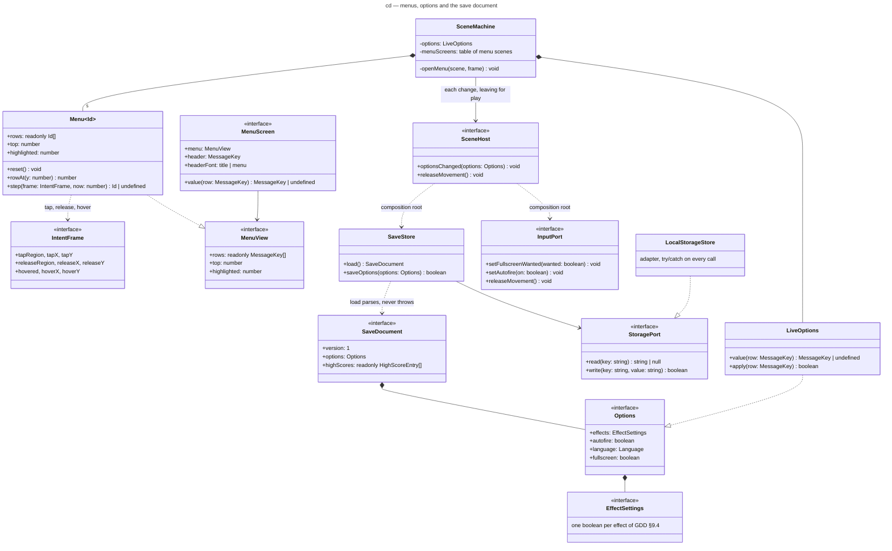

# Class diagram — meta — menus, options and the save document (G1a)

> **Source specs**: [Game Design Document](../../../design/game-design-document.md) v0.13 and v0.14 §9.1
> (menus; v0.14: leaving a menu frees the movement), §9.3 (options and their layout), §9.4, §9.8
> **Related ADRs**: ADR-0006 (save document, `StoragePort`), ADR-0009 (fullscreen at the next
> gesture), ADR-0015 (the last device used), ADR-0020 decision 4 (the autofire option), ADR-0021
> (the high-score entry)
> **Realizes**: UC5 of [01-use-case](../system/01-use-case.md); the `Options` and `Visual
> effects` states of [05-state-scenes](05-state-scenes.md)

## Context

The types the screens brick's first part (G1a) adds outside the simulation: one menu model for
every menu, the options and their save. It does not cover the remap rows (G1b), the high-score
table (G2) or the volumes (G3).

## Diagram

## Notes

- **One menu model** for the title, the pause, Confirm quit, the options and the visual effects
  (five menus, built once): the `SceneMachine` builds each menu's rows from data, so a later row
  (high scores, controls, audio) is a data addition. A row whose screen does not exist yet is not
  in the list. Rows are message keys; there is no row-kind class (G1a-3 design, KISS): a row is a
  switch or a choice only because its screen's `value(row)` gives it a value (*ON* / *OFF*,
  *ENGLISH* / *FRANCAIS*), and the scene machine knows what activating it does. A new left or
  right direction on a highlighted row activates it like `Confirm`, detected on the edge like up
  and down (GDD v0.14 §9.1): every value has two states.
- **Runtime options and `SceneHost`** (G1a-3): `LiveOptions` (`src/domain/options.ts`) holds the
  options while the game runs and knows what each row shows (`value`) and what activating it
  changes (`apply`); the scene machine only routes (G1a-3 anti-pattern review: it no longer owns
  the option rules). The presenter reads the same `EffectSettings` object, so a switch applies at
  the next frame; the language is read at each draw. After each change it calls `SceneHost.optionsChanged`, and on
  every exit from a menu towards play (*Play*, *Resume*, `back` and the pause button in the
  pause) `SceneHost.releaseMovement` (GDD v0.14 §9.1). The composition root implements the host: it saves through `SaveStore` and forwards
  autofire, fullscreen and the movement release to the `InputPort` — so the domain never sees
  the browser and the scene machine never sees storage.
- **`InputPort` gains `setAutofire` and `releaseMovement`** (ADR-0009 contract, G1a-3):
  `setAutofire` is ADR-0020 decision 4's option. `releaseMovement` drops the movement owner only
  if it is the mouse or touch (it sets the arbitration's `clearedAt` in that case); unlike a lost
  focus (ADR-0015 decision 5) it clears no held button and queues no pause, and a keyboard or
  gamepad owner keeps the ship, a held direction included.
- **Options and Visual effects are reached from the title and from the pause**: four scenes
  sharing two menus (meta/05-state-scenes), so `back` returns to the right parent.
- **The press and release rule lives in `Menu`** (built in G1a-2; the design's separate
  `PointerPress` was folded in, one caller only): a press within 150 ms of the last activation on
  the same row is ignored (a bouncing or doubled touch contact), and a release activates only over
  the row its press started on (GDD v0.13 §9.1). `now` is the scene machine's step count, never
  wall time. Rows are message keys, so a menu draws from the catalogue without building strings.
- **`IntentFrame` extension (ADR-0009 contract, G1a-2)**: besides the tap on press, the frame
  carries the release (`releaseRegion`, `releaseX`, `releaseY`: a lifted finger or the left
  button going up, none for a cancelled finger) and the mouse hover (`hovered`, `hoverX`,
  `hoverY`, play-field pixels, only when the cursor reaches a new field point).
- **`SaveStore` owns the schema rules, `StoragePort` only the strings** (ADR-0006 decision 3).
  `load()` falls back to the defaults on a missing, unreadable or unknown document, and
  `prefers-reduced-motion` presets the effect switches on a first launch only (GDD §9.3).
  `saveOptions` writes the whole document once per change, never inside the fixed step
  (ADR-0006 decision 6); `false` means the session goes on without saving.
- **`EffectSettings`** is the presentation's existing switch set (six switches today: blink,
  hit flash, explosions with the debris, shake, bomb flash, slow motion); the visual-effects
  screen lists exactly its switches, and an effect added later brings its switch and row.
- **`highScores`** stays an empty list until the hall of fame (G2) fills it. The options shape
  of G1a is version 1; the remap (G1b) and the volumes (G3) change it, so each bumps `version`
  with a migration function, as ADR-0006 decision 4 requires.
- **Layering (G1a-2 review)**: `Menu` (scenes) depends on `presentation/menu-layout` for the row
  height and centring; presentation draws a `MenuView` / `MenuScreen` and never imports scenes.
  The scene machine keeps one table of menu scenes (menu, header, header font) and one
  `openMenu(scene)`, so a new menu screen is one entry plus its step method. `Options` and
  `EffectSettings` live in `src/domain/options.ts`, shared by the presenter, the save store and
  the options screen.
- `Language`, `MessageKey` and `HighScoreEntry` are the existing catalogue and save types.
