# Class diagram — meta — menus, options and the save document (G1a)

> **Source specs**: [Game Design Document](../../../design/game-design-document.md) v0.13 and v0.14 §9.1
> (menus; v0.14: leaving a menu frees the movement), §9.3 (options and their layout), §9.4, §9.8
> **Related ADRs**: ADR-0006 (save document, `StoragePort`), ADR-0009 (fullscreen at the next
> gesture), ADR-0015 (the last device used), ADR-0020 decision 4 (the autofire option), ADR-0021
> (the high-score entry)
> **Realizes**: UC5 of [01-use-case](../system/01-use-case.md); the `Options` and `Visual
> effects` states of [05-state-scenes](05-state-scenes.md)

## Context

The types the screens brick's first part (G1a) adds outside the simulation: one menu model for
every menu, the options and their save. It does not cover the remap rows (G1b), the high-score
table (G2) or the volumes (G3).

## Diagram

```mermaid
---
title: cd — menus, options and the save document
---
classDiagram
  class Menu~Id~ {
    +rows: readonly Id[]
    +top: number
    +highlighted: number
    +reset() void
    +rowAt(y: number) number
    +step(frame: IntentFrame, now: number) Id | undefined
  }
  class MenuView {
    <<interface>>
    +rows: readonly MessageKey[]
    +top: number
    +highlighted: number
  }
  class MenuScreen {
    <<interface>>
    +menu: MenuView
    +header: MessageKey
    +headerFont: title | menu
    +value(row: MessageKey) MessageKey | undefined
  }
  class SceneHost {
    <<interface>>
    +optionsChanged(options: Options) void
    +releaseMovement() void
    +capture methods of G1b, see the controls notes
    +countryOfLanguage() string | undefined
    +today() string
    +highScoresChanged(entries: readonly HighScoreEntry[]) void
  }
  class InputPort {
    <<interface>>
    +setFullscreenWanted(wanted: boolean) void
    +setAutofire(on: boolean) void
    +releaseMovement() void
    +setBindings(bindings: Bindings) void
    +startCapture(device: keyboard | gamepad) void
    +captureNext() BindingCapture
    +cancelCapture() void
    +label(code: string) string
  }
  class ControlsGrid {
    +row: number
    +column: 0 | 1
    +capturing: boolean
    +step(frame, now) GridAction | undefined
  }
  class BindingsEditor {
    <<functions>>
    +bind(bindings, device, intent, slot, input) Bindings
    +restore(bindings, device) Bindings
  }
  class ButtonNames {
    <<table>>
    standard-mapping index 0 to 15 to A, B, X, Y, LB, RB, LT, RT, SELECT, START, L3, R3, arrows
  }
  class Bindings {
    <<interface>>
    keyboard and gamepad slots per remappable intent, ADR-0012
  }
  class KeyLabels {
    adapter: learned code to character, layout map, fixed names
  }
  class SceneMachine {
    -options: LiveOptions
    -menuScreens: table of menu scenes
    -openMenu(scene, frame) void
  }
  class LiveOptions {
    +value(row: MessageKey) MessageKey | undefined
    +apply(row: MessageKey) boolean
  }
  class IntentFrame {
    <<interface>>
    +tapRegion, tapX, tapY
    +releaseRegion, releaseX, releaseY
    +hovered, hoverX, hoverY
  }
  class Options {
    <<interface>>
    +effects: EffectSettings
    +autofire: boolean
    +language: Language
    +fullscreen: boolean
  }
  class EffectSettings {
    <<interface>>
    one boolean per effect of GDD §9.4
  }
  class SaveDocument {
    <<interface>>
    +version: 2
    +options: Options
    +highScores: readonly HighScoreEntry[]
  }
  class HighScoreEntry {
    <<interface>>
    +name: string
    +country?: string
    +score: number
    +level: 1 | 2 | 3
    +date: string, YYYY-MM-DD
  }
  class HighScoreTable {
    +entries: readonly HighScoreEntry[]
    +qualifies(score: number) boolean
    +insert(entry: HighScoreEntry) number
  }
  class LetterGrid {
    +cells: readonly GridCell[]
    +cursor: number
    +step(frame, now) GridCell | undefined
  }
  class NameEntry {
    +name: string
    +country: string | undefined
    +step(frame, now) HighScoreEntry | undefined
  }
  class SaveStore {
    +load() SaveDocument
    +saveOptions(options: Options) boolean
    +saveHighScores(entries: readonly HighScoreEntry[]) boolean
  }
  class StoragePort {
    <<interface>>
    +read(key: string) string | null
    +write(key: string, value: string) boolean
  }
  class LocalStorageStore {
    adapter, try/catch on every call
  }

  SceneMachine *-- "5" Menu
  SceneMachine --> SceneHost : each change, leaving for play
  SceneMachine *-- LiveOptions
  LiveOptions ..|> Options
  SceneMachine *-- ControlsGrid
  SceneMachine ..> BindingsEditor : capture result, restore
  SceneMachine ..> ButtonNames : gamepad labels
  SceneMachine ..> InputPort : capture, keyboard labels
  KeyLabels ..> InputPort : behind label()
  Options --> Bindings : v0.15
  Menu ..> IntentFrame : tap, release, hover
  Menu ..|> MenuView
  MenuScreen --> MenuView
  Options *-- EffectSettings
  SaveDocument *-- Options
  SaveStore ..> SaveDocument : load parses, never throws
  SaveDocument *-- "0..10" HighScoreEntry
  HighScoreTable o-- "0..10" HighScoreEntry
  NameEntry *-- LetterGrid
  NameEntry ..> HighScoreEntry : builds
  SceneMachine *-- NameEntry
  SceneMachine *-- HighScoreTable
  SaveStore --> StoragePort
  LocalStorageStore ..|> StoragePort
  SceneHost ..> SaveStore : composition root
  SceneHost ..> InputPort : composition root
```

## Notes

- **One menu model** for the title, the pause, Confirm quit, the options and the visual effects
  (five menus, built once): the `SceneMachine` builds each menu's rows from data, so a later row
  (high scores, controls, audio) is a data addition. A row whose screen does not exist yet is not
  in the list. Rows are message keys; there is no row-kind class (G1a-3 design, KISS): a row is a
  switch or a choice only because its screen's `value(row)` gives it a value (*ON* / *OFF*,
  *ENGLISH* / *FRANCAIS*), and the scene machine knows what activating it does. A new left or
  right direction on a highlighted row activates it like `Confirm`, detected on the edge like up
  and down (GDD v0.14 §9.1): every value has two states.
- **Runtime options and `SceneHost`** (G1a-3): `LiveOptions` (`src/domain/options.ts`) holds the
  options while the game runs and knows what each row shows (`value`) and what activating it
  changes (`apply`); the scene machine only routes (G1a-3 anti-pattern review: it no longer owns
  the option rules). The presenter reads the same `EffectSettings` object, so a switch applies at
  the next frame; the language is read at each draw. After each change it calls `SceneHost.optionsChanged`, and on
  every exit from a menu towards play (*Play*, *Resume*, `back` and the pause button in the
  pause) `SceneHost.releaseMovement` (GDD v0.14 §9.1). The composition root implements the host: it saves through `SaveStore` and forwards
  autofire, fullscreen and the movement release to the `InputPort` — so the domain never sees
  the browser and the scene machine never sees storage.
- **`InputPort` gains `setAutofire` and `releaseMovement`** (ADR-0009 contract, G1a-3):
  `setAutofire` is ADR-0020 decision 4's option. `releaseMovement` drops the movement owner only
  if it is the mouse or touch (it sets the arbitration's `clearedAt` in that case); unlike a lost
  focus (ADR-0015 decision 5) it clears no held button and queues no pause, and a keyboard or
  gamepad owner keeps the ship, a held direction included.
- **Options and Visual effects are reached from the title and from the pause**: four scenes
  sharing two menus (meta/05-state-scenes), so `back` returns to the right parent.
- **The press and release rule lives in `Menu`** (built in G1a-2; the design's separate
  `PointerPress` was folded in, one caller only): a press within 150 ms of the last activation on
  the same row is ignored (a bouncing or doubled touch contact), and a release activates only over
  the row its press started on (GDD v0.13 §9.1). `now` is the scene machine's step count, never
  wall time. Rows are message keys, so a menu draws from the catalogue without building strings.
- **`IntentFrame` extension (ADR-0009 contract, G1a-2)**: besides the tap on press, the frame
  carries the release (`releaseRegion`, `releaseX`, `releaseY`: a lifted finger or the left
  button going up, none for a cancelled finger) and the mouse hover (`hovered`, `hoverX`,
  `hoverY`, play-field pixels, only when the cursor reaches a new field point).
- **`SaveStore` owns the schema rules, `StoragePort` only the strings** (ADR-0006 decision 3).
  `load()` falls back to the defaults on a missing, unreadable or unknown document, and
  `prefers-reduced-motion` presets the effect switches on a first launch only (GDD §9.3).
  `saveOptions` writes the whole document once per change, never inside the fixed step
  (ADR-0006 decision 6); `false` means the session goes on without saving.
- **`EffectSettings`** is the presentation's existing switch set (six switches today: blink,
  hit flash, explosions with the debris, shake, bomb flash, slow motion); the visual-effects
  screen lists exactly its switches, and an effect added later brings its switch and row.
- **`highScores`** stays an empty list until the hall of fame (G2) fills it. The options shape
  of G1a is version 1; the remap (G1b) and the volumes (G3) change it, so each bumps `version`
  with a migration function, as ADR-0006 decision 4 requires.
- **Layering (G1a-2 review)**: `Menu` (scenes) depends on `presentation/menu-layout` for the row
  height and centring; presentation draws a `MenuView` / `MenuScreen` and never imports scenes.
  The scene machine keeps one table of menu scenes (menu, header, header font) and one
  `openMenu(scene)`, so a new menu screen is one entry plus its step method. `Options` and
  `EffectSettings` live in `src/domain/options.ts`, shared by the presenter, the save store and
  the options screen.
- `Language`, `MessageKey` and `HighScoreEntry` are the existing catalogue and save types.
- **Controls (G1b, GDD v0.15 §4.2)**: `ControlsGrid` is the two-column menu of the controls
  screen (seven intent rows with two slot cells, then *Restore defaults* and *Back*): up and
  down change the row, left and right the column, `confirm` or a tap on a cell starts the
  capture; it shares `Menu`'s press, release and opening-guard rules. `BindingsEditor` is pure
  domain: `bind` puts the captured input in the slot and exchanges it with the slot that held it
  on the same device; when that would empty another intent's primary, its secondary moves up,
  and when it has none `bind` refuses (the capture goes on), so no intent is left unbound;
  `restore` resets one device. The scene machine
  asks the input port to `startCapture`, polls `captureNext` each step until `key`, `button` or
  `cancelled` (the keyboard's `Escape`, the gamepad's 5 s), and cancels on a tap, on leaving or
  on an automatic pause trigger; the answering step reads no menu action. The capture answers
  only the edited device and only the capturable set of GDD v0.15 §4.2 (a closed list; refused
  keys leave it waiting), and the adapter prevents every key's default meanwhile but `Escape`'s.
  Gamepad labels come from the domain's `ButtonNames` table. Keyboard labels are split by
  language (G1b-2): `InputPort.label` answers only the character a letter or digit key prints
  (`KeyLabels` in the adapter: learned from the session's key events, then the layout map turned
  to capitals once, then US; `''` for any other key), and the domain names the other keys through
  the catalogue (*SPACE* / *ESPACE*, *SHIFT L* / *MAJ G*, the arrow glyphs, *NUM 0*…) with the
  screen (G1b-3).
- **Where the binding rules live (G1b-1)**: `REMAPPABLE_INTENTS` in the input port (the
  `RemappableIntent` type derives from it); `domain/input/capturable.ts` the capturable set;
  `domain/input/bindings-editor.ts` `bind` and `restore` (which also refuse an input outside the
  set); `domain/input/parse-bindings.ts` the save document's bindings parsing, so the save store
  only versions and migrates the document.
- **Save version 2**: `Options` gains `bindings`; version 1 migrates by adding the defaults
  (ADR-0006 decision 4); the bindings are parsed by allowlist (every key code from the capturable
  set, every index from 0 to 15, primary present, no duplicate), a failing device getting its
  defaults back.
- **Hall of fame (G2, GDD v0.16 §9.1)**: `LetterGrid` is the two-dimensional menu of the name
  entry (cells of 30 × 20 px, eight to a row; the directions move a wrapping cursor, `confirm` or
  a release over the pressed cell picks it, with `Menu`'s guards); its cells are characters or
  the actions *SPACE*, *DEL*, *OK*, *SKIP* and *NONE*. `NameEntry` builds the name (8 at most,
  `back` deletes; on *OK* trimmed; *SKIP*, or an empty or all-space name, records nothing) then the country (letters only, *OK* only for a code of
  `COUNTRY_CODES`, *NONE* for none), preselected by the host from the browser language
  (ADR-0021 decision 4), and returns the `HighScoreEntry` with the date the host gives
  (`SceneHost.today()`, the domain reads no clock). `HighScoreTable` keeps ten entries, best
  first, a score above 0 entering only above the tenth, ties after the older; `SaveStore` parses
  the stored entries by allowlist (ADR-0021 decisions 2, 3, 6) and saves the table with the
  options (`saveHighScores`). The entries first ship under the save's version 2 (G1b): the empty
  `highScores` written since G1a-1 is parsed by the same allowlist, no version bump and no
  migration (ADR-0021 decision 7's "version 1" overtaken, noted in the ADR).

