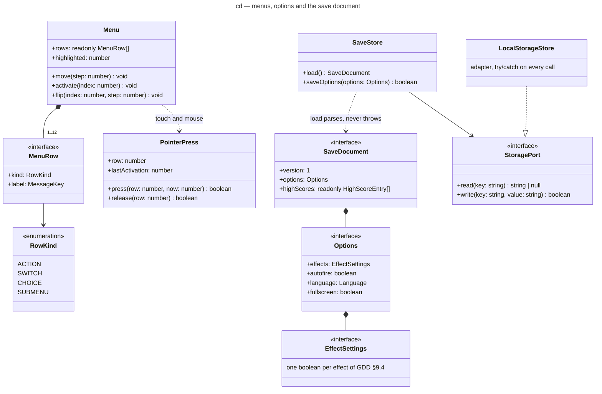

# Class diagram — meta — menus, options and the save document (G1a)

> **Source specs**: [Game Design Document](../../../design/game-design-document.md) v0.13 §9.1
> (menus), §9.3 (options and their layout), §9.4, §9.8
> **Related ADRs**: ADR-0006 (save document, `StoragePort`), ADR-0009 (fullscreen at the next
> gesture), ADR-0015 (the last device used), ADR-0020 decision 4 (the autofire option), ADR-0021
> (the high-score entry)
> **Realizes**: UC5 of [01-use-case](../system/01-use-case.md); the `Options` and `Visual
> effects` states of [05-state-scenes](05-state-scenes.md)

## Context

The types the screens brick's first part (G1a) adds outside the simulation: one menu model for
every menu, the options and their save. It does not cover the remap rows (G1b), the high-score
table (G2) or the volumes (G3).

## Diagram

## Notes

- **One menu model** for the title, the pause, the options and the visual effects: the
  `SceneMachine` builds each menu's rows from data, so a later row (high scores, controls,
  audio) is a data addition. A row whose screen does not exist yet is not in the list.
- **`PointerPress`**: `press` refuses a press within 150 ms of the last activation on the same
  row (a bouncing or doubled touch contact) and otherwise remembers the row; `release` activates
  only over the remembered row (GDD v0.13 §9.1). The time comes from the clock port, never
  `Date.now()`.
- **`SaveStore` owns the schema rules, `StoragePort` only the strings** (ADR-0006 decision 3).
  `load()` falls back to the defaults on a missing, unreadable or unknown document, and
  `prefers-reduced-motion` presets the effect switches on a first launch only (GDD §9.3).
  `saveOptions` writes the whole document once per change, never inside the fixed step
  (ADR-0006 decision 6); `false` means the session goes on without saving.
- **`EffectSettings`** is the presentation's existing switch set (six switches today: blink,
  hit flash, explosions with the debris, shake, bomb flash, slow motion); the visual-effects
  screen lists exactly its switches, and an effect added later brings its switch and row.
- **`highScores`** stays an empty list until the hall of fame (G2) fills it. The options shape
  of G1a is version 1; the remap (G1b) and the volumes (G3) change it, so each bumps `version`
  with a migration function, as ADR-0006 decision 4 requires.
- `Language`, `MessageKey` and `HighScoreEntry` are the existing catalogue and save types.
