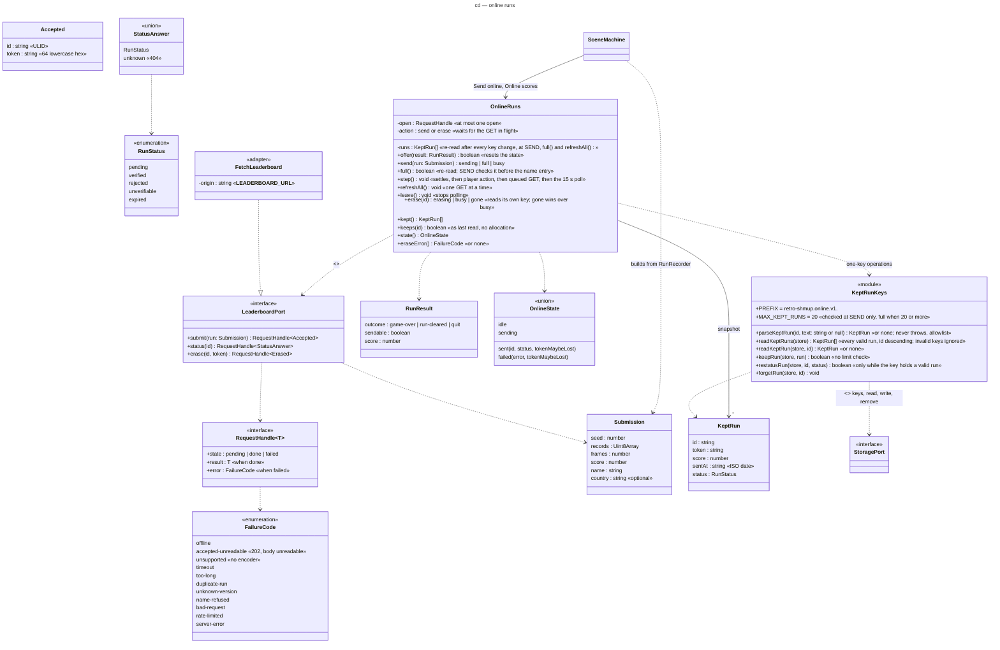

# Class diagram — meta — online runs, the leaderboard port and the kept runs (v0.40)

> **Source specs**: [Game Design Document](../../../design/game-design-document.md) v0.35, v0.36, v0.37, v0.40 §9.1
> (*Send online*, send errors #173, *WAIT* #177), §9.3 (*Online scores*), §9.8
> **Related ADRs**: ADR-0006 (untrusted stored data), ADR-0031 (decisions 12–21), ADR-0032 (one key per run)
> **Realizes**: UC9 and UC10 of [01-use-case](../system/01-use-case.md); the `OnlineRuns` and
> `FetchLeaderboard` components of [03-component](../system/03-component.md)

## Context

How the domain talks to the leaderboard without importing the browser or awaiting a promise: it
starts a request through `LeaderboardPort` and reads the returned handle on later steps. The kept
runs live one per key under `retro-shmup.online.v1.<id>`, each parsed like the save (never throws;
an invalid key or value is ignored, never removed; ADR-0032).

## Diagram

## Notes

- **No promise in the domain**: the adapter settles the handle when `fetch` ends; `OnlineRuns.step`
  reads `state` once per simulation step, like any other port read. One request is open at a time.
- **Every answer is untrusted**: the adapter parses each body by allowlist; a `202` whose body fails
  the parse settles as `accepted-unreadable` (the run is stored), any other 2xx as `server-error`. Ids must be ULIDs, tokens 64 lowercase hex characters.
- **The token** goes only into the `DELETE` header; it is never logged and never placed in a URL.
- **`unknown`** (a `404` on `status`) removes the kept run's key; a failed `erase` keeps it and sets
  `eraseError`, never the send screen's state.
- **Token maybe lost** (decision 19): a failed `POST` that may have stored the run (`offline`,
  `timeout`, `duplicate-run`, `accepted-unreadable`), or a `202` whose token the storage refused,
  sets `tokenMaybeLost` and the screen shows *TO ERASE SEE PRIVACY*.
- **Leaving while sending**: a `202` that arrives after `leave()` is kept for *Online scores*
  but not followed, and the state stays idle. A send left before its answer is never reported,
  even when its token may be lost: the privacy page is the way back.
- **One key per run** *(ADR-0032, #175)*: each kept run lives under `retro-shmup.online.v1.<id>`;
  `KeptRunKeys` owns the key layout, `OnlineRuns` never builds a key.
  Keeping a run after a `202` writes its key without checking the limit (concurrent tabs may keep
  more than 20); a status answer rewrites its key only while that key still holds a valid run;
  `unknown` and an erasure answered `204` or `404` remove the key. Two tabs never drop each
  other's run; the short read-then-write window can bring an erased run back until its next `GET`
  answers `unknown`.
- **Lines**: the scene maps `OnlineState` and `eraseError` to message keys (PR 3b of #167).
- **Built (#167, 3b-2)**: `main.ts` builds `OnlineRuns` over `FetchLeaderboard` and the
  browser's storage only when the build's leaderboard origin is set (ADR-0031 decision 12); the
  privacy page is `<origin>/privacy`. *Online scores* (`OnlineScoresScreen`) reads `kept()` by
  identity each step and rebuilds its page on a change only.
