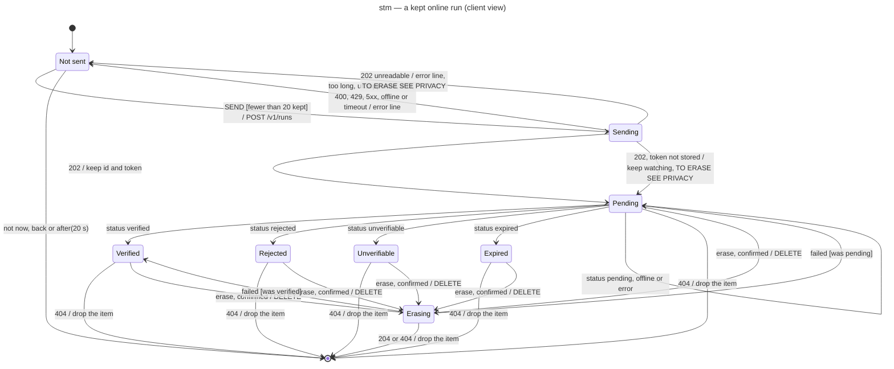

# State machine diagram — meta — a run sent online, as the game sees it (v0.35)

> **Source specs**: [Game Design Document](../../../design/game-design-document.md) v0.35 §9.1
> (*Send online*), §9.3 (*Online scores*), §9.8
> **Related ADRs**: ADR-0031; retro-leaderboard ADR-0001 (verdicts), ADR-0004 (erasure)
> **Realizes**: UC9 and UC10 of [01-use-case](../system/01-use-case.md)

## Context

The client's copy of one run's status, kept in `retro-shmup.online.v1`. The server's own state
machine is retro-leaderboard `05-state-run`; the game only mirrors the statuses `GET /v1/runs/{id}`
returns and forgets the run once it is erased. Notation: `trigger [guard] / effect`.

## Diagram

## Notes

- **When the status is asked**: the status screen every 15 s for 2 minutes at most while the run
  is pending; *Online scores* once per opening for every kept run, so a run the server erased by
  its retention (`404`, retro-leaderboard ADR-0004) leaves the list and frees its slot.
- **A failed erasure returns to the status it left** (drawn for two statuses; the three others
  likewise).
- **A stored status outside the five** is an invalid item, dropped by the parser (ADR-0006); its
  token is lost with it, which only a hand-edited storage can cause.
