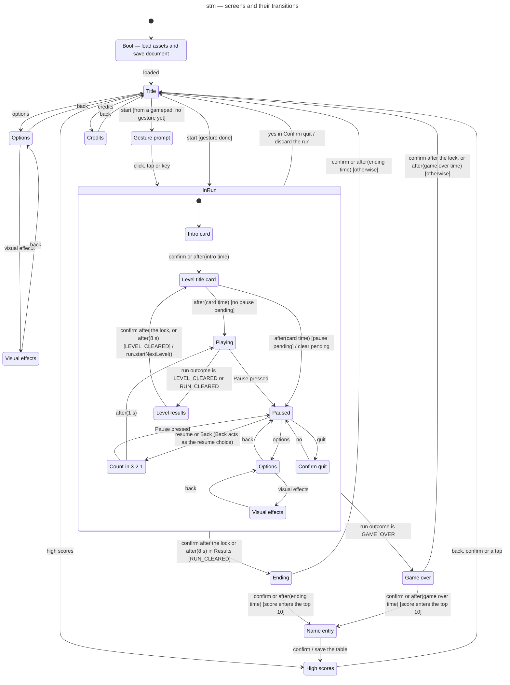
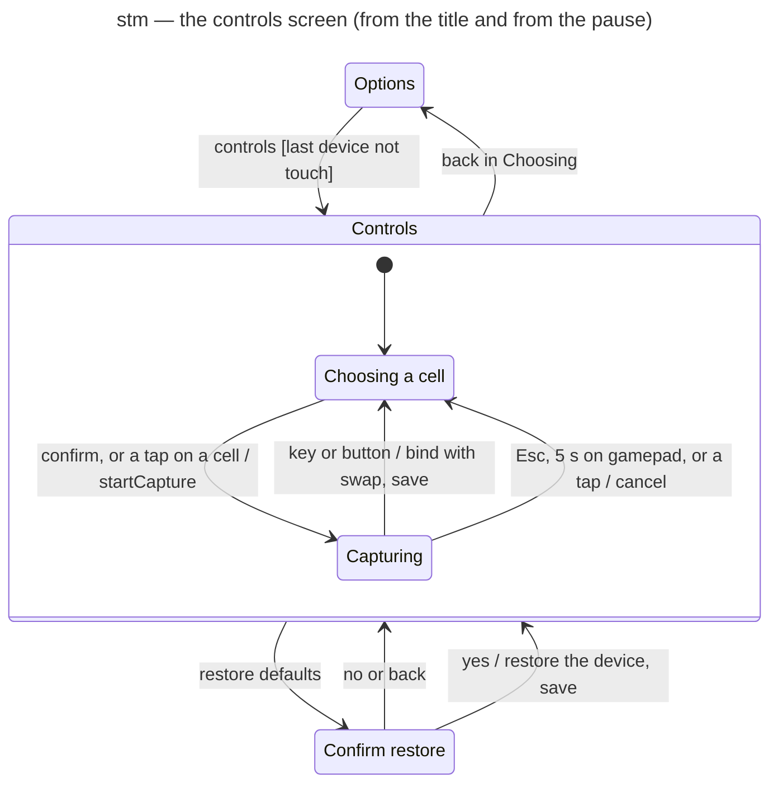
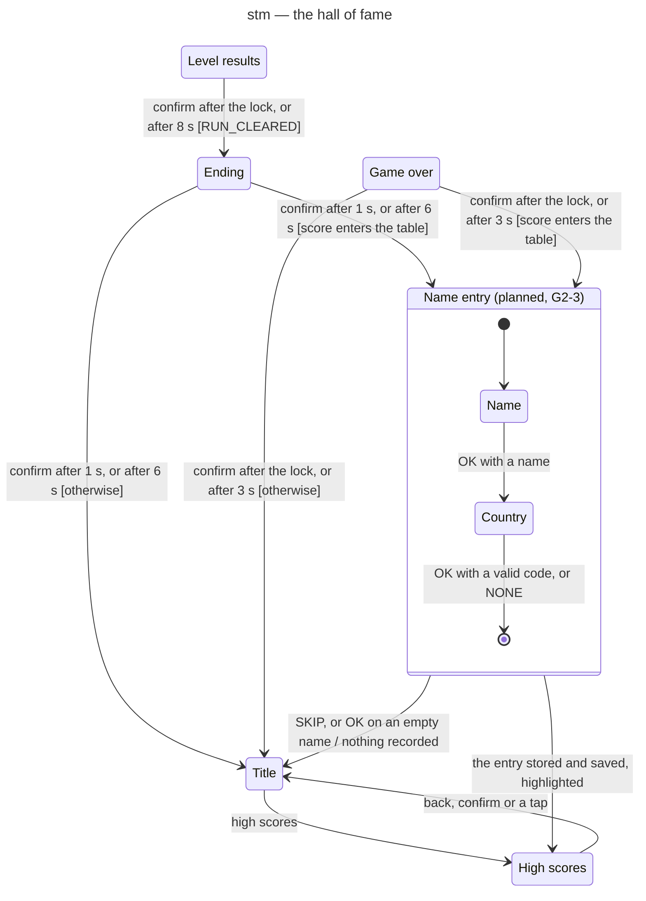

# State machine diagram — meta — screens and their transitions (1.0)

> **Source specs**: [Game Design Document](../../../design/game-design-document.md) v0.10 §3.2, §3.4,
> §4.2, §4.3–§4.6, §5.2.1, §6, §7.2.1, §7.2.2, §7.3, §8, §9.1, §9.2, §9.3, §9.4, §9.7; v0.13 §9.1 menus, §9.3 options layout
> **Related ADRs**: ADR-0006 (save document), ADR-0009 (gestures, automatic pause), ADR-0010
> (one run, one bus), ADR-0015 (pause in the first playable), ADR-0018 (taps, locks, pause button),
> ADR-0019 (run seed, player-kit build order), ADR-0020 (pointer fire, autofire option), ADR-0021 (hall of fame entry), ADR-0022 (level
> brick, `Results`, the one-level slice)
> **Realizes**: UC1–UC7 of [01-use-case](../system/01-use-case.md) at the screen level; the
> `SceneMachine` component of [03-component](../system/03-component.md)

## Context

Every screen of the game and what moves between them — the `SceneMachine`. It owns the active
`Run` while one exists, reads its outcome after each step, and is the only place where the
pause is decided (02-sequence-fixed-step-tick). Notation: `trigger [guard] / effect`.

## Diagram

## Notes

- **`InRun` entry creates the run** (`entry / new Run`, with its own event bus and `RunPresenter`);
  the run is released when `Title` is next entered (from `Confirm quit`, `Game over` or `Name
  entry`). `Ending` and `Name entry` keep the finished run read-only (`RunView`), never step it,
  and read its snapshot and score; `Game over` keeps stepping it without the ship (below). A new run never inherits listeners of the
  previous one (ADR-0010).
- **Edges leaving `InRun` start from one substate**: Mermaid draws them from the composite
  boundary, so the label names the substate (`yes in Confirm quit`, `confirm in Results`); `Game
  over` is reached from `Playing`, when the run's outcome becomes `GAME_OVER` at the end of the
  death sequence (05-state-player).
- **Pause rules** (GDD v0.4 §9.1, ADR-0009):
  - in `Playing`, only `Pause` enters `Paused`, before the run steps; `Back` is ignored in play, so
    the gamepad `B` (bomb and back) never pauses. The keyboard `Esc` sets both `Pause` and `Back`:
    it pauses in play and resumes from the pause;
  - in `Paused`, `Pause` does nothing — automatic triggers can only enter the pause — and `Back`
    resumes like the menu choice;
  - in `Count-in`, `Pause` returns to `Paused`, so an automatic trigger never lets the game resume
    unfocused;
  - in a card or the results, `Pause` (player or automatic) sets a **pending pause** flag, applied
    when play starts and cleared when leaving `InRun`;
  - every other scene ignores `Pause`.
- **The time scale** returned to the loop is 1 in every scene except `Playing` (ADR-0010).
- **Options and Visual effects are two states each, sharing one screen implementation** (GDD
  v0.13 §9.3), so `back` returns to the right parent without a history pseudostate; the pause
  pair keeps the simulation frozen like `Paused`.
- **Gesture prompt** exists only for a start from a gamepad before any click, tap or key press;
  the audio unlock itself happens in the input adapter's handler (ADR-0009).
- **Name entry** follows both Ending and Game over when the score qualifies (GDD v0.2 §9.1); a run
  quit from the pause never reaches it. High scores then show the new entry highlighted (UC3).

## First-playable subset (first playable brick)

The first playable build implements part of this machine; each later brick adds states until the
diagram above is complete. The game it ships is described by the GDD and the ADRs; this section
alone records the build order and the interim deviations of each brick.

- **States**: `Boot` → `Title` → `InRun { Playing }`. `Boot` loads nothing yet (no assets, no
  save document); the run's lifetime follows the notes above.
- **Start**: `Confirm` pressed (keyboard `Enter` in C1, gamepad `A` from C2), or a tap or click
  anywhere on the title (C2). `Pause` is ignored on the
  title, as in every scene other than play (pause rules above).
- **Interim deviation, cards**: `InRun [*] --> Playing` until the intro and level title cards
  land with the bitmap fonts and the message catalogue (screens brick), when it becomes
  `[*] --> IntroCard` again.
- **Interim deviation, gesture**: `Title --> InRun : start` has no `[gesture done]` guard until
  `Gesture prompt` lands with audio. That brick decides where the "a gesture happened" signal
  lives (the intent frame, or `AudioPort`, which owns the unlock), and makes a touch start count
  as a gesture on `pointerup` (ADR-0015 decision 8).
- ~~**Interim deviation, pause** (first playable only)~~: removed by the pause PR of the enemies
  brick — `Paused` and `Count-in` landed and replaced the pinned "`Playing` ignores `Pause`" test.

### Enemies brick additions

The enemies brick adds `Paused`, `Count-in` and `Game over`, and removes the pause deviation above.

- **Paused** follows the pause rules above: `Pause` in `Playing` enters it before the run steps;
  `Confirm` or `Back` starts `Count-in`; `Pause` in `Count-in` returns to `Paused`. **Interim
  deviation, pause menu**: the menu's options, quit and confirm-quit choices need text and arrive
  with the screens brick; until then `Paused` offers resume only. It draws the frozen field
  under a dim veil and a two-bar pause icon made of rectangles.
- **Count-in** shows a 3-2-1 with the HUD digits, centred on the field, for 1 s (GDD §9.1), the
  run still frozen. On its last step it hands over to `Playing` and the run steps in that
  same step, so the first resumed frame interpolates forward from the frozen picture, never back.
- **Game over**: `InRun --> GameOver` when the outcome is `GAME_OVER`. **Interim deviation,
  name entry**: `GameOver --> Title` on `Confirm` or after the game-over time (GDD §4.4), with no
  `NameEntry` branch until the high scores exist (screens brick). Arcade style (GDD v0.6 §4.4):
  the run keeps stepping without the ship — the script, enemies and their bullets go on, the
  player's last bullets are spent so the score never moves — the starfield scrolls, and a large
  "GAME OVER" from the message catalogue (`title` font) is drawn over a dim veil. The HUD keeps
  reading the run: the score stays, while a chain restarted during the death sequence still
  drains its bar. The screens
  brick adds the other languages and the options that choose one.
- **Frozen scenes** (`Paused`, `Count-in`) take every step without stepping the run
  (except the last Count-in step, which hands over to `Playing`, above)
  and do not advance the background clock. `SceneMachine.render` picks the frame's alpha once:
  `alpha = 1` for the whole frame, starfield and snapshot, so nothing wobbles between two
  positions (02-sequence-fixed-step-tick); and it hands the presenter `wallDtMs = 0`, so effects
  freeze too. Effects get `wallDtMs = 0` when the current scene is frozen **or** a frozen step ran since the
  last render: the scene machine sets a flag on every frozen step and clears it at render, so the
  count-in handoff frame (already `Playing`) ages no effect either, and a frozen frame with no
  step at all (above 60 Hz) stays frozen by the scene's trait.
- **Scene traits**: what differs between scenes for drawing and timing (`frozen`, `scrolls`,
  `drawsRun`) is one data table, `SCENE_TRAITS`, read by `step`, `render` and `timeScale`; each
  scene keeps one private method for its transitions. The veil, the pause icon and the 3-2-1 are
  pure draw functions of the presentation module, never drawn by the navigator (ADR-0010).
  Scene objects (State pattern, ADR-0003) wait until the screens brick brings the machine to
  about ten states. Count-in and game-over times live in `SceneTuning` (`tuning.ts`).
- ~~**Interim deviation, level script**: since F-1 the level script holds the 120 s rows of GDD
  v0.10 §7.2.1 and §7.2.2 and its time wraps to 0 at 120 s, the slot of the absent WARNING
  (`LevelScript.loopAt`; 45 s before F-1, the slot of the then-absent Heavy); enemies of the
  previous pass stay alive. It loops until the level brick adds the rest of level 1, the
  warning and the boss: no `LEVEL_CLEARED`, no `BossDefinition` and no `warningAt` before then.~~
  **Lifted by the level brick**: F-1 replaced the rows with the 120 s script, still wrapping at
  120 s; F-2a removed `loopAt`: the script ends at `warningAt` 120 s with the Cruiser (level
  brick additions below).
- ~~**Interim deviation, drops and formations**: no `DropTable` roll, no full-formation P, no
  `Formation` count, no death release of the weapon and no bombs until the pickups and rules
  brick, so `Run` holds no `Random` yet and the determinism test compares (script, inputs) only.~~
  Removed by the player-kit brick (E-1 brings the seed, the drops and the formations; E-4 the
  release and the bombs; player-kit brick additions below).
- **Strategies of the enemies brick**: it builds `PathMovement`, `DiveMovement`,
  `EnterHoldLeave`, `NoAttack` and `AimedAttack`; `RingAttack` and `FanAttack` were added with the Heavy by F-1; only the event kinds the
  brick publishes are added.
- **Brick subset, enemies**: `Body` keeps only what the three roles need — `age` replaces
  `pathProgress` (the S curve is a closed form of the age), and `origin`, `hover`, `velocity`,
  `width` and `height` carry the spawn and hover points, the dive or leave heading and the
  hitbox; `HitRules.destroyEnemy` takes no cause (only shots exist), and ~~`Bullet` has no
  pierce memory (`canHit`, `recordHit`) until the Laser~~ (lifted by E-2).

### Presentation of the first playable

- **Title**: the starfield in the field and empty HUD bands; no ship, no text (fonts arrive with
  the screens brick).
- **Playing**: the starfield, the ship and its bullets as rectangles in palette colours (no
  sprite before the assets brick), empty HUD bands; the ship flies in from below (GDD §4.1).
- **Background clock**: the scene machine counts the starfield's scroll time in steps of the
  scenes that scroll (Title, Playing), so the starfield is continuous across the start and
  freezes with hit-stop and in the frozen scenes (enemies brick additions).
- **Interim deviation, blink**: the blink is always on; its non-flashing replacement and its
  reduced-motion default (GDD §9.3, §9.7) arrive with the options screen (screens brick).
- **Enemies brick**: enemies and enemy bullets are rectangles in palette colours that differ
  from the ship's hull colour (the smoke-test oracle); `RunPresenter` picks the colour from the
  archetype id or size tier, never from archetype data (ADR-0010). The left HUD band shows the
  score, the multiplier, the chain bar and the reserve lives (GDD §9.2), top to bottom, with
  margins of at least 8 px; their positions are one record in `presentation/hud-layout.ts`
  (landscape only until C2) drawn by a `drawHud` function that `RunPresenter` calls. Digits are
  drawn by the renderer until the bitmap fonts of the screens brick: a font draws only its glyph
  set and throws on any other character, `hud` being `0-9` and `×` (the `RenderPort` contract) — *(level brick, F-3)* plus a space,
  an empty cell, for the Results values.
  Numbers are drawn digit by digit (`% 10`, one `drawText` per digit from a constant table of
  one-character strings), with no cache and no formatting, so drawing the HUD never allocates.
- **Smoke test** (the single browser test, ADR-0003; extended by the devices brick, below):
  Chromium only, against the built bundle.
  The ship's palette colour is absent at its resting point on the title, then present there after
  `Enter` and at least 30 frames. The logic time per step is measured and logged against the
  4 ms budget (ADR-0002 decision 7), not asserted.

### Devices brick additions (C2)

The devices brick makes the game playable on a phone, with a gamepad and with a mouse (GDD v0.7
§4.2, §4.4, §9.1, §9.2; ADR-0015, ADR-0018).

- **Screens**: `hud.ts` draws the whole HUD from `layout()` — the landscape bands or the portrait
  strip, the pause button and the contents — at the `HUD_LAYOUTS` positions; the scene machine
  only chooses when (traits). The field, the overlays (veil, pause icon, count-in, GAME OVER) and
  the presenter's field drawing are field-relative and need no change.
- **Portrait strip** (240 × 32, `hud` coordinates): score {x 4, y 4}, 8 digits; reserve lives
  {x 76, y 5}, 8 px icons every 12 px (8 icons end at x 168); multiplier {x 4, y 18}; chain bar
  {x 24, y 21, 42 × 4}, ending under the score's last digit; a 1 px edge line at y 31 over x 0 to
  191; the pause button over the strip's right end. The landscape layout keeps its current
  positions.
- **Pause button**: two 4 × 16 bars 4 px apart, centred in its rectangle, in its own palette
  colour over the band colour; drawn when the scene's `pauseButton` trait is true (`Playing`,
  `Paused`, `Count-in`), whatever the device.
- **Locks**: from the step that enters `Game over`, `Confirm` and taps are ignored for
  `toSteps(gameOverLockSeconds)` = 60 steps and accepted from the 61st; the 180-step timer counts
  from the same entry (the entering step is step 0 for both). A `Title` entered from `Game over` applies the same 60-step lock; the first
  `Title` never does.
- **Interim deviation, tap resume** (lifted by G1a): until the pause menu, any tap or click also
  starts `Count-in` from `Paused`.
- **Interim deviation, gamepad start before a gesture**: unchanged (first-playable subset above);
  the gesture prompt comes with audio.

| Scene | Pause-button tap | Other tap or click | `Confirm` (Enter, A, Start) | `Pause` (P, Esc, Start) | `Back` (Esc, B) |
|---|---|---|---|---|---|
| `Title` | (not drawn) | activates the menu row under it, on release, after the lock (G1a-3; before: starts a run) | activates the highlighted row (*Play* first), after the lock | ignored | ignored |
| `Playing` | `Paused`, before the run steps | field: steering finger; HUD: nothing | ignored | `Paused`, before the run steps | ignored |
| `Paused` | `Count-in` | activates the menu row under it, on release (G1a; before: `Count-in`, interim) | activates the highlighted row | ignored | `Count-in` |
| `Options`, `Visual effects` (title) | (not drawn) | activates the row under it, on release | activates the highlighted row | ignored | parent screen |
| `Options`, `Visual effects` (pause) | (not drawn) | activates the row under it, on release | activates the highlighted row | ignored (`Esc` acts as `Back`) | parent screen (`Paused` from `Options`) |
| `Confirm quit` | (not drawn) | activates the row under it (*No* or *Yes*), on release | activates the highlighted row, *No* first | ignored (`Esc` acts as `Back`) | `Paused` |
| `Count-in` | `Paused` | ignored | ignored | `Paused` (wins over `Confirm`, so `Start` returns to `Paused`) | ignored |
| `Game over` | (not drawn) leaves after the lock | leaves after the lock | leaves after the lock | ignored | ignored |
| `Controls` (title, pause; G1b) | (not drawn) | on release over a cell: starts its capture; over *Restore defaults* or *Back*: that row; while capturing: cancels | starts the capture of the highlighted cell, or activates its row | ignored (`Esc` acts as `Back`; while capturing, `Escape` cancels and `Start` is bindable) | parent `Options` (while capturing: not a menu action) |
| `Confirm restore` (title, pause; G1b) | (not drawn) | activates the row under it (*No* or *Yes*), on release | activates the highlighted row, *No* first | ignored (`Esc` acts as `Back`) | `Controls` |
| `High scores` (G2) | (not drawn) | a tap started on the screen leaves on its release (the opening tap never does) | `Title`, locked 1 s | ignored | `Title`, locked 1 s |
| `Ending` (G2) | (not drawn) | leaves after the 1 s lock | leaves after the 1 s lock; after 6 s it leaves on its own | ignored | ignored |

### Player-kit brick additions (E)

The player-kit brick gives the player the whole kit of GDD v0.8 — both weapons on five levels,
the five pickups, bombs, the shield and the death rule — with the drop sources and the Carrier
(GDD v0.8 §4.3–§4.6, §5.2.1, §7.2.1, §9.2; ADR-0019). The Heavy, the ring and fan attacks, the
boss and the end-of-level tally wait for the level brick (F).

- **Run creation**: the composition root gives the scene machine a run factory that draws the
  run seed with `Math.random`; the scene machine calls it on entering `InRun`, as today. Tests
  pass a factory with a fixed seed, or a scripted `Random` through `RunConfig.createRandom`. Nothing else changes in the scenes:
  pickups, bombs and the shield live inside `Run`, so `Paused`, `Count-in` and the frozen-scene
  rules freeze them with everything else, and `Game over` lets the pickups fall past the missing
  ship.
- **Field drawing** (placeholders until the sprites): pickups are 16 × 16 shapes in their own
  palette colours — a P capsule carrying the weapon badge's mark (three dots for P-red, a
  vertical bar for P-blue), a hollow square for the Shield, a plus for the Bomb, a small ship
  for the 1-UP — so no two kinds differ by colour only (GDD §9.7); the Carrier is a rectangle in
  its own colour; Laser bolts in their own colour; the shield ring is a 36 × 36 outline of four
  rectangles around the ship, drawn while a charge is held and hidden with the ship (`Dead`,
  blink).
- **HUD**: `HUD_LAYOUTS` gains `bombs`, `weapon` (`x`, `y`, `pipX`, `pipSpacing`) and `shield`
  for both screens, at the GDD v0.8 §9.2 positions — portrait: bombs {x 76, y 19}, weapon
  {x 140, y 19, pipX 152, pipSpacing 6}, shield {x 172, y 5}; landscape: bombs {x 8, y 66},
  weapon {x 368, y 84, pipX 380, pipSpacing 6} (badge x 368–376, pips ending at x 407),
  shield {x 368, y 100}. Icons are 8 × 8, pips
  3 × 8; `hud.ts` draws them from the snapshot, with no text and no allocation.
- **Effects**: `EffectSettings` gains `shake` and `bombFlash`, separate switches, on by default
  and off — with `hitFlash` — when the browser reports `prefers-reduced-motion`, read once by the
  composition root at boot (GDD v0.8 §9.3, §9.4); the shake moves field draws only (ADR-0014), the flash tints
  the field for about 300 ms of wall time and starts at most once per 1/3 s. Both freeze in the
  frozen scenes like the other effects.
- **Interim deviation, first-time labels**: no "SHIELD", "BOMB", "1UP" label (GDD §7.3) until the
  bitmap fonts of the screens brick — the `title` font has only A–Z and space; `PICKUP_SPAWNED`
  already carries the kind.
- **Interim deviation, Bomb Carrier**: the level script holds a second Carrier at 40 s carrying a
  Bomb (GDD v0.8 §7.2.1), the only Bomb source until the level brick brings the Heavy; the row is
  removed then. **Lifted by F-1** (the Heavy and the 120 s script).
- **Interim deviation, 1-UP unsourced**: the 1-UP pickup exists and is collectable, but no script
  row carries it before the level brick (a 1-UP every 45 s loop would be too generous).
  **Lifted by F-1**: one 1-UP Carrier at 78 s (GDD v0.10 §7.2.2).
- **Interim deviation, no touch bomb button**: no bomb button is drawn (GDD v0.8 §4.2); the
  second-finger tap stays the only touch bomb, and the right click the mouse bomb. Revisited
  with the options and screens.
- ~~**Interim deviation, weapon tables (E-1 → E-2)**~~: lifted by E-2, which fires the
  `WEAPONS` tables. E-1 brought `Weapon.kind`, `level`,
  `powerUp` and the HUD badge and pips, but until E-2 `WEAPONS` holds the level-1 Spread record
  for every level and both kinds: the level, the kind and the pips change, the shot does not.
- ~~**Interim deviation, E-1 to E-4**~~: lifted by E-4 (bomb, shield absorption, death rule). A
  Shield caught before E-4 sets the charge and its HUD icon
  but absorbs nothing; Bomb pickups raise the stock (the cap bonus at 5) with no effect, the bomb
  itself arriving in E-4; death keeps the power and the bombs until E-4 (no `powerDown`, no
  release, no bombs reset).
- **Brick subset, player kit**: `DifficultyProfile` holds only the knobs the brick reads (`lives`,
  `bombsPerLife`, `dropRateScale`; the power lost on death stays a rule, one level); `FORMATION_CLEARED` and `BOMB_USED` are
  published but `LevelTally` waits for the level brick; `damageBoss` waits for the boss.

### Design revision v0.9 (after the brick-E playtest)

GDD v0.9 and ADR-0020 change no state and no transition of the diagram; they change what some
bricks deliver.

- **Pointer fire** (ADR-0020 decisions 1 to 3 and 6): the mouse fires while the left button is held
  after a press on the field, touch while a finger steers; the held pointer `Fire` combines like
  any button. **Done** by the pointer-fire PR (#32, `91691e4`) before brick F.
- **Interim deviation, no autofire option**: until the options screen (screens brick G), pointer
  fire is always the held fire; the v0.8 always-on fire is not reachable (ADR-0020 decision 4).
- **Field drawing, shot proportions** (GDD v0.9 §3.2; presentation only, the hitboxes and the
  snapshot do not change): `RunPresenter` draws enemy bullets 6 × 6 centred on their 4 × 4 box
  with a 2 × 2 white core, Spread bullets 2 × 6 centred on their 2 × 8 box, Laser bolts at 60 %
  opacity, player shots translucent. Enemy bullets stay drawn on top (player-kit additions). With
  the pointer fire PR, before or in F's first PR; the sprites of the assets brick keep the
  proportions. **Done** by the same PR (#32).
- **Difficulty ramp** (GDD v0.9 §7.1, §10): the level brick F replaces the 45 s interim loop with
  the real ~120 s level-1 script rising to the Heavy, then the boss.
- **Named top 10 and country** (GDD v0.9 §8, §9.1, §9.8): the screens brick G brings the name
  entry (8-character letter picker, skip as `???`, country preselected from the browser
  language's region), the save-document schema and its allowlist validation (ADR-0006,
  ADR-0021: first `version: 1` with `name` and `country`, no migration), and the bitmap font glyphs the entry needs (A–Z, 0–9, space, `?`). The pixel flags wait for the
  assets brick.

### Level brick additions (F)

The level brick turns level 1 into a whole level — the 120 s script, the Heavy, the WARNING, the
Cruiser, the tally and the results — and ends the vertical slice after it (GDD v0.10 §6, §6.1,
§7.2.2, §8, §9.1, §9.2, §9.4; ADR-0022). It adds one state, `Results`; the diagram above is
unchanged.

- **Results**: `Playing --> Results` when the outcome is `RUN_CLEARED` (and, from level 2,
  `LEVEL_CLEARED`). Traits: `frozen` (the run does not step, alpha 1, effects get `wallDtMs = 0`),
  `scrolls` (the starfield keeps moving — a new combination of the two traits), `drawsRun`, no
  pause button. Over a dim veil, the tally lines of GDD v0.10 §8 appear one every
  `toSteps(ResultsTuning.lineSeconds)` = 30 steps, read from `RunView.tally()`: label in the
  `title` font from the message catalogue (FORMATIONS, NO BOMB, NO MISS, BOMBS, TOTAL; FR
  FORMATIONS, SANS BOMBE, SANS PERTE, BOMBES, TOTAL — A–Z and space only), value right-aligned on
  the row below in the `hud` font (digits, × and the space glyph F-3 adds), a missed bonus shown with 0. `Confirm` and taps
  are ignored for `toSteps(ResultsTuning.lockSeconds)` = 60 steps and accepted from the 61st; the
  scene leaves on its own after `toSteps(ResultsTuning.autoSeconds)` = 480 steps (the entering step
  is step 0 for all three, as for Game over). The values live in `ResultsTuning`, beside
  `SceneTuning`.
- **Exits**: `Confirm` or a tap after the 60-step lock, or the 480-step (8 s) timer, whichever
  comes first: `LEVEL_CLEARED` → the next level's card (`run.startNextLevel()`), `RUN_CLEARED` →
  `Ending` in 1.0, `Title` in the one-level slice (interim, below).
- ~~**Interim deviation, slice end**~~ (lifted by G2-2: `Results --> Ending`): `Results --> Title` for `RUN_CLEARED`, releasing the run,
  instead of `Ending` and `Name entry` (screens brick G); the `Title` reached from `Results`
  applies the 60-step lock, as from Game over. `LEVEL_CLEARED → LevelCard` waits for level 2.
- ~~**Interim deviation, F-2 before F-3**~~ (built in F-2a): lifted by F-3 — the "LEVEL CLEAR"
  banner for 3 s is replaced by the tally lines, the lock and the 8 s exit above;
  `ResultsTuning.levelClearSeconds` is removed.
- **Built in F-3**: a header "LEVEL CLEAR" (FR "FIN DU NIVEAU", the `levelClear` message, `title`
  font, centred at y 16) stands above the lines (owner decision 2026-10-12, GDD v0.10 §8); the
  lines start at y 52, one every 48 px, labels at x 8, values right-aligned to x 232 at y + 24, so
  the TOTAL value ends at y 278 in both screens (the field region). The first line shows on the
  entering step, the TOTAL from step 120. The values are formatted once on entry from
  `RunView.tally()`; each frame only draws them.
- **Pause**: during `Results` a `Pause` (player or automatic) sets the pending pause, as during a
  card; in the slice it is cleared when the run is released at the title. **Interim deviation,
  pending pause (F-3)**: since the slice's `Results` lead to the title and never back to play,
  the code keeps no pending pause: `Pause` and `Back` are simply ignored in `Results`, which is
  the same behaviour; the pending flag arrives with the next-level flow (brick G). During the WARNING and
  the fight the pause rules are unchanged: the run, the boss timer and the banner freeze with it.
- **The time scale** stays 1 in every scene but `Playing`, where the presenter returns 0.5 for
  0.5 s of wall time after `BOSS_DESTROYED` when `EffectSettings.slowMotion` is on (ADR-0010
  decision 2); a pause during the slow motion freezes its wall-time clock like every effect.
- **Field drawing** (placeholders until the sprites): the Heavy a 56 × 48 rectangle in its own
  colour; the Cruiser a 112 × 48 rectangle with its forward turret drawn as a separate rectangle
  until phase 2; enemy bullets as today. The **WARNING** banner ("WARNING", FR "ATTENTION",
  `title` font, centred on the field) is drawn while the snapshot's boss state is `WARNING`,
  visible for the first 0.75 s of each 1.5 s — two blinks in 3 s, under 3 per second (GDD v0.10
  §9.7). The **HP bar** (a 1 px outline over x 8–232, y 4–8, filled in proportion to the HP left,
  a 1 px tick at 66 %) and the **seconds left** (HUD digits right-aligned in the box x 218–232, y 12–22) are
  drawn in the field region from `ENTERING` until the `DESTROYED` or `FLEEING` sequence ends.
- **Effects**: `EffectSettings` gains `slowMotion`, on by default and off under
  `prefers-reduced-motion` (composition root, as `hitFlash`); the explosion sizes gain a Large
  tier (the Heavy) and a boss tier; the debris — a few fragments flying from the broken part —
  is recorded on `BOSS_PHASE_CHANGED` and drawn behind the `explosions` switch. Each effect is
  outcome-neutral (ADR-0010).
- **Strings**: the message catalogue gains `warning`, `levelClear` (interim), and the five tally
  labels, EN and FR.

### Screens brick additions (G1a, GDD v0.13)

- **States**: `Options` and `Visual effects` from the title and from the pause (the diagram
  above); the pause menu's *Resume*, *Options*, *Quit* rows and `Confirm quit` (lifting the
  tap-resume and pause-menu interim deviations). `Boot` reads the save document
  (`SaveStore.load`, which never throws and parses by allowlist with `parseBindings` in
  `domain/input/parse-bindings.ts` and `parseHighScores` in `domain/hall-of-fame/high-scores.ts`,
  ADR-0006) and gives the options to the composition root; the title showed *Play* and *Options*
  in G1a, and shows *Play*, *High scores* and *Options* since G2-2.
- **Menu rows** (GDD v0.13 §9.1): one model for every menu — a list of rows, one highlighted,
  each row an action, a switch, a choice or a sub-screen. Keyboard and gamepad move with up and
  down and activate with `confirm`; touch and mouse activate on release over the pressed row,
  with a 150 ms re-press guard; hover highlights. No timer anywhere.
- **Options applied at once**: a switch updates `EffectSettings` (the presenter reads it each
  frame), *Autofire* updates the pointer module (ADR-0020 decision 4), *Language* the message
  catalogue, *Fullscreen* asks the viewport adapter, applied at the next gesture if needed
  (ADR-0009). Each change writes the save document once, outside the fixed step.
- **G1a-2 (built)**: the pause menu (*Resume*, *Quit*; the PAUSE header in the title font
  replaces the wordless pause icon) and `Confirm quit` (*No* first; *Yes* discards the run and
  locks the title for 1 s like Game over); the `menu` font (the title letters at 2×); the
  pointer release and hover in the intent frame. The *Options* row joins the pause menu with
  the options screen (G1a-3).
- **G1a-3 (design, GDD v0.14)**: `Title` becomes a menu (*Play*, *Options*; a stray tap no longer
  starts a run, the 60-step lock after Game over and Results stays); `Options` and `Visual
  effects` from the title (scrolling) and from the pause (frozen, the pause menu gains
  *Options*); every change applies at once and reaches `SceneHost.optionsChanged`; every exit
  from a menu towards play (*Play*, *Resume*, `back` and the pause button in the pause) calls
  `SceneHost.releaseMovement`. The title lock ignores the whole menu, highlight moves included.
- **Not yet**: `Credits`, the gesture prompt's audio part, the audio sub-screen (G3, G4); the
  controls screen is G1b's and the hall of fame G2's (below).

### Screens brick additions (G1b, GDD v0.15)

- `Controls` and `Confirm restore` exist twice, from the title (scrolling) and from the pause
  (frozen), like `Options`. While `Capturing`, and in the step that receives the answer, `back`
  and `Pause` are not menu actions: the keyboard's `Escape` cancels through the capture itself,
  and the gamepad's `B` and `Start` are bindable buttons. Leaving the scene, a tap, or an
  automatic pause trigger (tab hidden, focus lost, the active gamepad lost) cancels the capture
  and the screen stays in `Choosing`; on the pause side the run was already paused, on the title
  side nothing pauses.

### Build order

| Brick | Delivers |
|---|---|
| C1 — first playable on keyboard | the subset above; `Player`, `PlayerState`, `Weapon` with Spread level 1, player bullets; `RunPresenter`; `DeviceInput` with its façade and the `keyboard` module; ADR-0015 decisions 4 (keyboard part), 5 (lost focus), 6 and 9; the smoke test |
| D — enemies | Popcorn, Diver, Gunner as archetype data and stateless strategies; `LevelDirector` with the looping rows of GDD §7.2.1; `ActiveList` for player bullets, enemy bullets and enemies; `CollisionResolver` with `HitRules`; lives, `hit()`, `Dead` and respawn; `EventBus` with `ScoreKeeper` (points and chain); `RunOutcome.GAME_OVER`; `Paused`, `Count-in`, `Game over`; HUD digits, chain bar and life icons; hit flash and small explosion behind effect switches; an ESLint rule keeping `src/domain/game` from importing `presentation` and `scenes`; the `RenderPort` glyph-set contract |
| C2 — the other devices | five PRs (ADR-0018): C2-0 this design; C2-A the browser-free arbitration (no behaviour change); C2-L the portrait screen (`RenderPort.layout()`, `HUD_LAYOUTS`, `hud.ts` draws bands or strip, page CSS); C2-P touch and mouse (`pointer` module, pause button, tap resume, Game over and title locks, crosshair, layout-change pause, the new smoke test); C2-G the gamepad (`gamepad` module, fixed `A`/`B`/`Start` roles) |
| E — the player kit | five PRs (ADR-0019), each merge playable: E-0 this design; E-1 randomness, pickups and their sources (run seed, pickup pool, fall and sway, collision pass 4, P-red and P-blue, `Weapon.kind` and `level` with `powerUp`, the cap bonus, `Formation` with the formation P and `FORMATION_CLEARED`, `LevelScript.dominantColour`, the Gunner `DropTable` at 30 %, the `DifficultyProfile` subset, the HUD weapon badge and pips, the determinism test with a seed; until E-2, `WEAPONS` holds the level-1 Spread record for every level and both kinds: the level, the kind and the pips change, the shot does not); E-2 the weapons on levels 1 to 5 (the data tables, damage in tenths, Laser bolts, pierce memory, the player bullet pool at 80); E-3 the Carrier (`CrossMovement`, the archetype, cargo with its load checks, the §7.2.1 rows, the Shield, Bomb and 1-UP pickups collectable, the HUD shield and bomb icons as needed); E-4 the bomb, the shield and the death rule (step slot 3, `useBomb`, `BOMB_USED`, flash and shake, `ABSORBED`, `shieldBroken`, `PLAYER_HIT`, the ring, `powerDown` with the release hop and the bombs reset). The Carrier comes before the bomb, so Shield and Bomb are catchable as soon as they exist |
| Pointer fire and shot proportions | ADR-0020 decisions 1 to 3 and 6 (mouse left-button fire latch, touch fire while steering, samples with `autofire = false`) and the GDD v0.9 §3.2 drawn sizes in `RunPresenter`; done by #32 (`91691e4`) before F (design revision v0.9 above) |
| F — the level | PRs F-0 to F-3 (ADR-0022, F-2 split by ADR-0023), each merge playable: F-0 design (GDD v0.10, ADR-0022); F-1 the strategy factories (the Gunner refactor first, no behaviour change), `Body.volleys`, `SizeTier.LARGE`, the Heavy (ring and fan archetypes, its drop), the ring and fan attacks, the 120 s script of GDD v0.10 §7.2.2 with the 1-UP Carrier and without the Bomb Carrier (interim: it still wraps at 120 s), the level simulation at ≤ 16 enemies and ≤ 40 enemy bullets; F-2 the boss, in three PRs (ADR-0023: F-2-0 its design; F-2a the domain — `fire`/`tick` patterns and group sequences, `warningAt`, `startBoss`, `Boss` and `BossState`, the Cruiser's `BossDefinition`, `BossTuning`, `damageBoss` in pass 1 and the bomb, the boss body in pass 3, the boss events, `RunOutcome.LEVEL_CLEARED` and `RUN_CLEARED` over the level list, the snapshot's boss view, `loopAt` removed, the boss drawn as grey rectangles, interim `Results` with the "LEVEL CLEAR" banner for 3 s, then the title; F-2b the HUD — the WARNING banner (`drawWarning`, a scene overlay read from the boss state under the pause veil), the HP bar with the 66 % tick and the seconds (`drawBossBar`, drawn by the presenter); F-2c the game feel — the debris, the Large and boss explosion tiers, the slow motion and its switch; built as animated explosions in style A without white (a shrinking core, deterministic fragments, a boss core reduced to 0.3 × its size), the ship's explosion on `PLAYER_DIED`, the boss chain of 1 + 6 bursts 1/3 s apart, `EffectSettings.slowMotion` off under reduced motion); F-3 `LevelTally`, `TallyTuning`, `RunView.tally()`, the `Results` lines, lock and 8 s exit, `RUN_CLEARED` → `Results` → `Title`, the documentation pass |
| G1a — menus and options | GDD v0.13: the menu-row model, the title and pause menus, `Confirm quit`, the options and visual-effects screens, the `localStorage` adapter of `StoragePort` and the options part of the save document, every string EN and FR (the section above) |
| Later bricks | screens brick (G1b remap, G2 hall of fame, G3 audio, G4 art): the Ending card and the name entry after a cleared run (lifting the slice-end deviation), the bitmap fonts with the first-time pickup labels, a touch bomb button if the screens revisit it (GDD v0.8 §4.2), the name entry with the letter picker and the optional country, and the save-document schema for the named top 10 (GDD v0.9 §9.1, §9.8) |

### Screens brick additions (G2, GDD v0.16)

- **Lifts the slice-end interim**: a cleared run goes Results → Ending, no longer to the title.
- **Interim deviation, no name entry until G2-3** (owner, 2026-10-15): `Ending` and `Game over`
  both go to `Title` (released run, 60-step lock) whatever the score, until the name entry of
  G2-3 lands; the `[score enters the table]` branches and `Name entry --> High scores` are
  planned, G2-3. `Title --> High scores` and `High scores --> Title` (on `back`, `confirm` or a
  tap started on the screen) are built (G2-2, `HighScoresScreen`).
- **Name entry** keeps the finished run read-only for its score and level; the `back` intent
  deletes, it never leaves (only *SKIP*, or *OK* on an empty name, leaves without recording). `Pause` and the automatic pause
  triggers are ignored in `Ending`, `Name entry` and `High scores` (no run steps). The `Escape`
  key sends `back` too, so it deletes like the gamepad's `B`.
- **Opening guard**: the press that opens `Name entry` or `High scores` never acts there (a tap
  must start on the new screen, §9.1); the title reached from `High scores` is locked for 1 s, as
  after Game over.
- **The letter grid** is one model for both steps (the country step shows the letters only, with
  *DEL*, *NONE* and *OK*), sharing `Menu`'s press, release and opening-guard rules; the cursor
  moves in two dimensions and wraps.
- `High scores` scrolls the background like the title; `Ending` keeps the run frozen behind it, as
  `Results` does.

