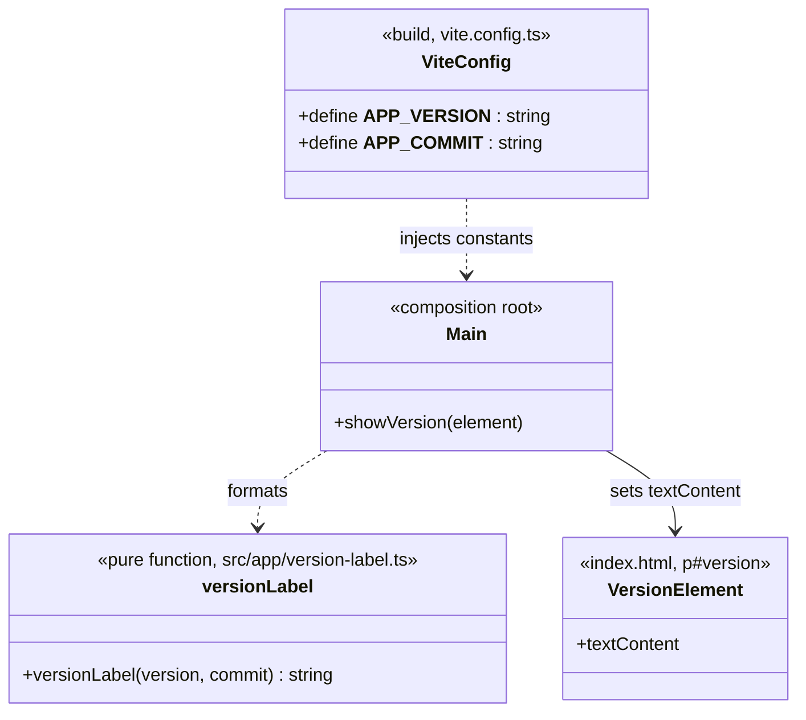
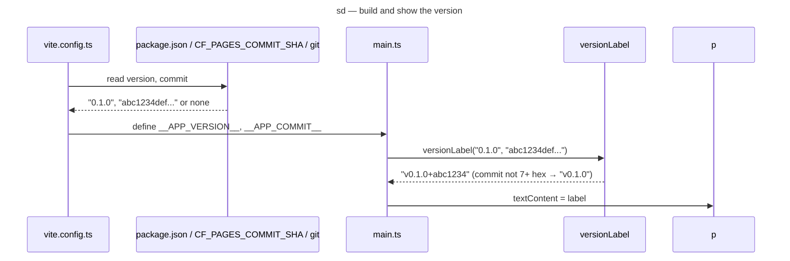

# Class and sequence diagram — meta — the version label (v0.20)

> **Source specs**: [Game Design Document](../../../design/game-design-document.md) v0.20 §9.9
> **Related ADRs**: ADR-0025 decision 6 (version shown in the game), ADR-0003 (composition root),
> ADR-0008 (CSP: no inline style or script)
> **Realizes**: the "version label" of §9.9; no use case of its own (the player does nothing)

## Context

The version never enters the domain: the build resolves it into two constants, the composition
root formats them with one pure function and writes the result into a page element with
`textContent`. Nothing is read at run time, no port is needed.

## Diagram

## Rules the code must satisfy

- The commit is accepted only if it matches `^[0-9a-f]{7,40}$` (cut to 7); anything else is
  dropped, never shown (the value comes from the environment).
- git is queried with `execFileSync` and an argument list, never a shell; a failure means "no
  commit".
- The element is styled from `style.css` (CSP `style-src 'self'`), ignores pointer events.
