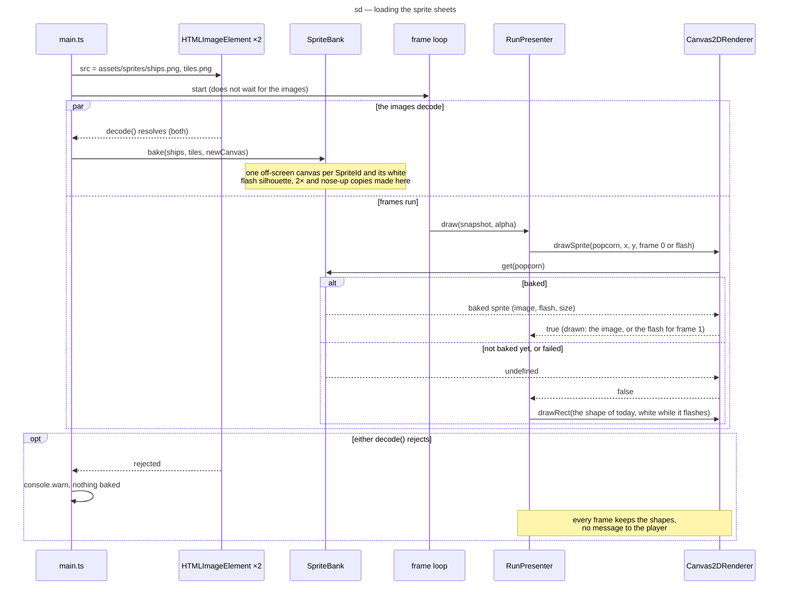

# Sequence diagram — render — loading the sprite sheets and the fallback (G4-1)

> **Source specs**: [Game Design Document](../../../design/game-design-document.md) v0.17 §3.2.1
> (the fallback: the game starts at once on its shapes)
> **Related ADRs**: ADR-0001 amendment 2026-10-15, ADR-0008 (CSP `img-src 'self'`)
> **Realizes**: the types of [04-class-sprites](04-class-sprites.md)

## Context

How the two sheets reach the renderer without delaying the first frame, and what a frame draws
before, after, or without them.

## Diagram

## Notes

- The sheets are same-origin files under `public/assets/sprites/`, so the CSP's `img-src 'self'`
  (ADR-0008) allows them and no canvas is tainted.
- `bake` runs only when both images decoded: a run never mixes sprites from one sheet with
  shapes for the other sheet's ids.
- Baking happens between two frames on the main thread; the sheets are small (≈ 2 KB and ≈ 4 KB),
  so it costs well under a frame.
