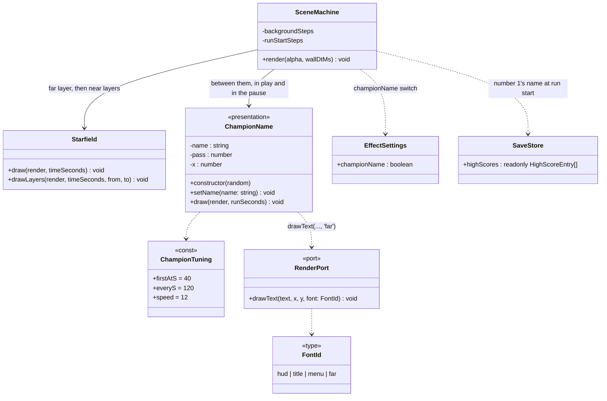
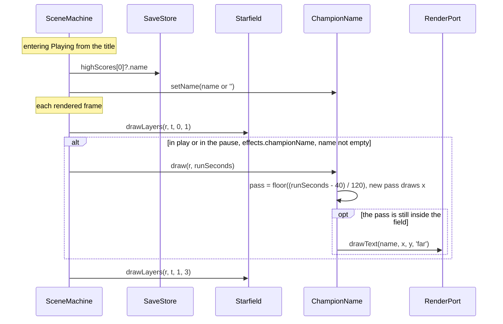

# Class and sequence diagram — render — the champion's name in the far background (v0.22)

> **Source specs**: [Game Design Document](../../../design/game-design-document.md) v0.22 §9.4.1,
> §9.3
> **Related ADRs**: ADR-0010 (presentation time, unseeded presentation randomness), ADR-0021
> (high-score table), ADR-0006 (save parsing by allowlist)
> **Realizes**: §9.4.1; no use case of its own (the player does nothing)

## Context

The name is background decoration, so it lives in the presentation next to the starfield and
reads only what the scene machine hands it: the number 1's name (from `SaveStore.highScores`),
the run's background time and the effect switch. The starfield is split so the name sits between
the far layer and the two nearer ones. The adapter gains one font id, `far`: the menu glyphs in
the far-star colour (the render port has no alpha).

## Diagram

## Notes

- `runSeconds` is the background time since the run started, so the pause and the frozen scenes
  stop the name with the stars. `y = -10 + 12 × (runSeconds − 40 − 120 × pass)` (−10: the menu cell's height); the name is drawn
  only while `y < 320`.
- `x` is drawn once per new pass from the presentation randomness, keeping the whole name inside
  the 240 px field: no gameplay draw, no allocation per frame.
- `EffectSettings.championName` is optional in the parsed save: missing means on, so save version
  2 is kept; a present non-boolean, `null` included, is invalid like any other switch.
- "In the pause" is every scene that is frozen and does not scroll (Paused, Count-in, the quit
  confirmation, the pause's options screens): the name stays where it was, like the stars.
