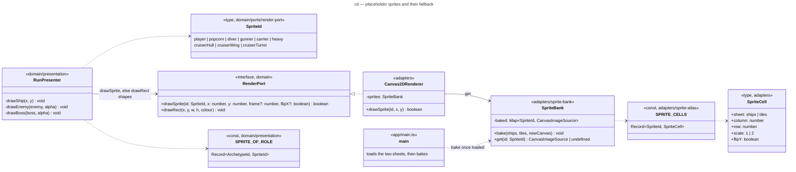

# Class diagram — render — placeholder sprites and their fallback (G4-1)

> **Source specs**: [Game Design Document](../../../design/game-design-document.md) v0.17 §3.2.1
> (the sprite per entity, the Cruiser composite, the fallback), §4.1, §5.2.1, §6.1
> **Related ADRs**: ADR-0001 and its 2026-10-15 amendment (`drawSprite` returns whether it drew,
> sizes and the player's flip baked at load), ADR-0005 (asset licences, `CREDITS.md`), ADR-0008
> (CSP: `img-src 'self'` already allows the sheets), ADR-0010 (presentation outside the outcome)
> **Realizes**: the drawing of every ship in [gameplay/02-sequence-fixed-step-tick](../gameplay/02-sequence-fixed-step-tick.md)

## Context

The types G4-1 adds or changes to draw the ships with sprites. The domain names a sprite and
keeps its shapes; the adapter owns the images. Bullets, pickups, effects and fonts are out.

## Diagram

## Notes

- **Coordinates**: `drawSprite`'s (x, y) is the **centre** of the sprite in the selected region,
  rounded to whole logical pixels like every draw; the field camera offset applies. Every
  entity's position is already its centre, so no caller computes a corner.
- **Return value**: `true` when drawn; `false` while the sheet is not baked (loading, or failed).
  The presenter then draws the shape it draws today — the shapes stay in the domain, never
  copied into the adapter. An id is a member of the `SpriteId` union, so an unknown id does not
  compile; `SPRITE_CELLS` is a `Record<SpriteId, SpriteCell>`, so a missing cell does not either.
- **Baking**: `bake` runs once, outside the game loop: for each id it copies the cell into its own
  off-screen canvas at its scale (nearest neighbour), turned nose up when `flipY` (the player
  only). `get` and `drawSprite` allocate nothing. `heavy` and `cruiserHull` are the 2× cells.
- **The Cruiser** is three `drawSprite` calls: the wings at x ∓ 44, the hull at x, then the
  turret at the turret's offset (`CRUISER_TURRET`) while phase 0 and not flashing. If the hull
  draw returns `false`, the presenter draws the current boxes instead.
- **Hit flash** (§9.4): a flashing entity is drawn as its box in the flash colour, before any
  sprite lookup — unchanged.
- **`SPRITE_OF_ROLE`** maps the archetype id (`popcorn` … `heavy-ring`, `heavy-fan`) to a sprite,
  as `enemyColour` maps it to a colour today (ADR-0010: never stored in archetype data).
- `frame` and `flipX` stay unused (ADR-0001).
